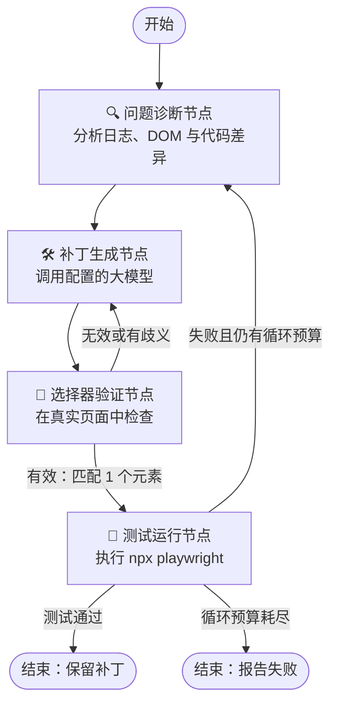
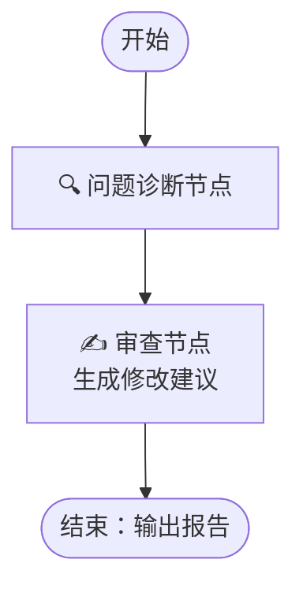

<a id="technical-architecture--white-paper-e2e-self-heal"></a>

# E2E-Self-Heal 技术架构与白皮书

本文介绍 **E2E-Self-Heal** 的架构、状态机智能体流程，以及自动修复 Playwright 端到端测试的主要组件。

---

<a id="-target-audience--goals"></a>

## 🎯 目标读者与设计目标

Playwright 广泛用于前端与质量保障团队。E2E-Self-Heal 虽然以 Python 库形式发布到 PyPI，但希望自然融入 Node.js／TypeScript 开发流程。

<a id="core-goals"></a>

### 核心目标

- **尽量减少配置：** 以少量设置接入本地工作区或 CI。
- **严格限制修改：** 只修复定位器和等待条件，不修改测试断言、测试意图或业务逻辑。
- **提前验证：** 在重新运行测试前，检查新选择器是否能在真实 DOM 中匹配，减少无效候选造成的重试。

---

<a id="-ai-agent-architecture-powered-by-langgraph"></a>

## 🤖 基于 LangGraph 的 AI 智能体架构

自动修复循环使用 **LangGraph** 状态机，提供明确的步骤转移、循环预算 `max_loops` 和职责划分。

<a id="1-self-healing-loop-flow"></a>

### 1. 自动修复循环

标准 `e2e-healer` 模式检测失败、生成补丁、验证选择器并重跑测试。下图展示简化主干；实际代码还包含历史复用、影子验证和拒绝判断，详见 [逐文件工作流分析](new_info/workflow-analysis.zh-CN.md)。



<a id="2-review-mode-flow-advisory-only"></a>

### 2. 审查模式：仅提供建议

审查图只生成诊断和源码修改建议，不修改文件，也不在图内执行测试。CLI 未提供 `--log` 时仍可先跑测试收集失败。



---

<a id="-core-components"></a>

## 🧩 核心组件

<a id="1-data-preprocessor"></a>

### 1. 数据预处理

发送到模型之前，先整理和压缩原始日志：

- **错误日志解析器：** 抽取堆栈位置、定位器失败与超时原因。
- **差异语法树分析器：** 提取变更的源码元素，帮助模型理解 UI 结构变化。

<a id="2-selector-verifier"></a>

### 2. 选择器验证

为减少模型生成不存在或不唯一的选择器：

- **真实 DOM 检查：** 通过临时 Node／Playwright 脚本打开应用地址 `APP_URL`，评估选择器。
- **匹配数量检查：** 要求恰好匹配 **1 个元素**。匹配 `0` 个或多于 `1` 个时否决该候选，让补丁生成节点继续改进；预算耗尽则停止。

工具或应用地址不可用时，该步骤可以跳过，由实际测试执行判断最终结果。

<a id="3-shadow-testing--matching-engine"></a>

### 3. 影子测试与匹配引擎

用于需要模拟后端网络依赖的测试场景。

- **请求规范化器 `RequestNormalizer`：** 清理 UUID、ISO／Epoch 时间戳等动态值，以及 `Authorization`、`Cookie`、`X-CSRF-Token` 等认证相关字段，生成稳定的请求签名。
- **匹配评分器 `MatchScorer`：** 使用可配置权重计算请求相似度：

  ```python
  @dataclass
  class ScoringWeights:
      exact_url_bonus: float = 150.0
      base_url_match: float = 100.0
      query_max: float = 30.0
      headers_max: float = 20.0
      body_max: float = 50.0
  ```

- **确定性选择：** 多个候选响应符合条件时，依次按以下规则选择：
  1. 分数从高到低。
  2. URL 完全相同优先。
  3. 路径完全相同优先。
  4. 使用稳定的原始索引排序；重复请求再按记录序列消耗响应。

---

<a id="-security--sandbox-boundaries"></a>

## 🔒 安全与沙箱边界

本地或 CI 中的智能体需要明确的执行边界：

- **文件写入限制：** 按沙箱策略读取源码上下文，将生成补丁限制在失败测试目标及允许的运行时产物。
- **命令检查：** 用于 `git diff` 和配置的 Playwright／Node 命令，避免 shell 展开和串联。当前实现检查参数中的 shell 控制语法，不是完整的可执行程序白名单，也不是操作系统级隔离。
