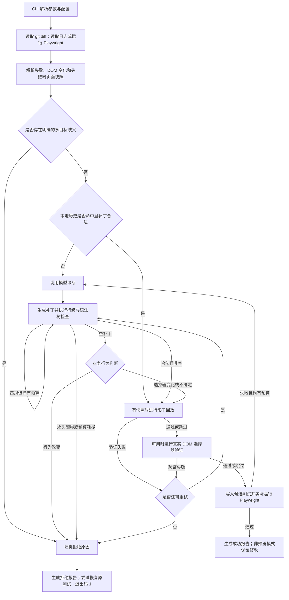

**E2E Self-Heal 实际工作流与逐文件功能分析**

分析对象为当前本地代码，日期为 2026-10-29。本文依据入口、函数体、导入关系和条件路由整理；没有执行真实模型调用、业务测试修复、数据库迁移或外部通知。因此，“已实现／已接入”描述的是代码路径，“运行成功”仍需在配置完整的环境中验证。

只覆盖参与运行、验证、结果接收或流程展示的源代码及必要配置。排除 README、gitignore、许可证、锁文件、贡献说明、文档站、发布脚本和与产品执行无关的仓库管理文件。`tests/` 是引擎自身的开发测试，不是修复用户测试时会逐一执行的文件；本次不逐个展开。`examples/scenarios/*/spec.ts` 则是被引擎实际执行的目标，属于分析范围。

**1. 先分清项目中的五条链路**

| 链路 | 启动入口 | 实际执行内容 | 当前边界 |
| --- | --- | --- | --- |
| 自动修复 | `e2e-healer heal`；省略子命令时默认进入 heal | 跑测试、收集证据、复用历史或调用模型、检查并验证补丁、保存成功修改 | 核心能力在 Python CLI 中；只允许改定位器与等待条件 |
| 只读审查 | `e2e-healer review`；Playwright Reporter 也会调用它 | 诊断失败并输出源代码修改建议 | 不自动应用建议；可能为了收集失败而先运行测试 |
| 影子回放 | 正常修复图中的条件节点；也有 `--shadow` 入口 | 使用已有快照拦截并重放浏览器请求 | 缺快照时跳过；裸 `--shadow` 仍返回占位消息 |
| 安全评测 | `e2e-healer safety-benchmark` | 对带标签的场景运行真实修复图、统计修复和拒绝质量 | 是评测工具，不是普通用户每次修复的必经步骤 |
| Web | 4174 的 `demo-page`；5173 的 `product/web` | 前者播放预设演示，后者显示 API 健康与版本 | 均没有网页创建真实修复任务的闭环；结果上传鉴权仍阻止上传 |

**2. 一次真实修复的执行顺序**

上图省略了历史候选被否决后回到模型诊断的细分分支。准确路由以 `app/graph.py` 为准。正常测试成功退出码为 0，修复未成功通常为 1，路径／配置／沙箱等入口错误通常为 2。不是所有“失败退出”都会生成拒绝报告。

`--dry-run` 仍会生成候选、临时写文件并运行测试，结束时恢复原文件；它不是只展示提示词的模式。

**3. 启动、配置与主控制文件**

| 文件／关键入口 | 执行时机 | 实际功能与输出 |
| --- | --- | --- |
| [pyproject.toml](H:/MyAgent/E2E/E2E-Self-Heal/pyproject.toml:1) | 安装与启动 | `[project.scripts]` 将 e2e-healer 注册为 app.cli:app；声明 Python 3.13+、LangGraph、模型 SDK、tree-sitter、Playwright 等运行依赖。只分析这些运行部分。 |
| [app/cli.py](H:/MyAgent/E2E/E2E-Self-Heal/app/cli.py:486) | 所有 CLI 模式 | Typer 入口。heal 分流单文件／目录／全套测试；_read_diff 读取 --diff、git diff 或 base...HEAD；--root 锚定路径与子进程工作目录；--selector-hint 注入人工目标提示。_heal_file 建初始状态、运行图、生成报告并决定保留或恢复文件；_heal_suite 聚合失败、逐文件修复并最终重跑整套测试。还包含 review、init、benchmark、safety-benchmark 与 --shadow 分支。 |
| [app/config.py](H:/MyAgent/E2E/E2E-Self-Heal/app/config.py:14) | 加载核心模块时 | 通过 Pydantic Settings 读取 .env 和 E2E_HEALER_*；校验模型、密钥配置、模型调用参数、测试超时、1～3 的修复预算、验证开关、工作区／写入规则及通知配置；兼容旧 NVIDIA 和 OrcaRouter 配置。配置对象在模块导入时建立。 |
| [app/graph.py](H:/MyAgent/E2E/E2E-Self-Heal/app/graph.py:217) | 每次修复或审查 | 建立 LangGraph 状态图与全部条件路由；负责成功终止、失败重试、模型空补丁的进一步判断和拒绝归类。_recorded 记录每个执行节点和候选实际去向。build_review_graph 另外建立“诊断→审查→结束”的图。 |
| [app/runner.py](H:/MyAgent/E2E/E2E-Self-Heal/app/runner.py:70) | 初次捕获失败、候选验证、全套复验 | 统一启动配置的 Playwright 命令，收集 stdout／stderr 并按退出码返回 (passed, log)。设置单次运行超时，隔离进程组，超时后尝试杀死测试及浏览器后代进程。它不调用模型。 |
| [app/state.py](H:/MyAgent/E2E/E2E-Self-Heal/app/state.py:105) | 整个修复图 | TypedDict 定义节点间共享状态：原始／当前／回滚代码、日志、DOM 差异、快照、诊断、补丁、各类验证结果、历史命中状态、候选证据、节点路径、loop_count、is_success 等；节点返回局部更新。 |
| [app/schemas.py](H:/MyAgent/E2E/E2E-Self-Heal/app/schemas.py:57) | 模型输出与 CLI／API 边界 | Pydantic 定义 DomDiff、定点替换指令、模型结构化结果、诊断枚举、7 类拒绝原因、证据、单文件／全套／审查报告和人工 SelectorHint。当前公开 JSON 契约为 2.3；termination 区分 verified、refused、budget_exhausted、verification_failed。 |
| [app/logging.py](H:/MyAgent/E2E/E2E-Self-Heal/app/logging.py:38) | CLI 启动和各节点输出 | 配置 structlog、日志级别与 stderr 输出；在呈现日志前递归脱敏。让 --json 的 stdout 可以被外层脚本读取。 |

**4. 证据预处理：把原始失败变成可判断的信息**

预处理的主要输入是 Playwright 日志、git diff、原测试源码和已有的 `test-results/**/error-context.md`。不是直接把整个仓库交给模型。

| 文件／关键入口 | 执行时机 | 实际功能与输出 |
| --- | --- | --- |
| [app/preprocess/error_log_parser.py](H:/MyAgent/E2E/E2E-Self-Heal/app/preprocess/error_log_parser.py:32) | 初始失败及每次测试失败后 | 抽取 Error、Locator、Expected／Received、strict-mode 多目标提示、源文件位置及少量 waiting for 调用记录；无匹配时保留日志末尾。输出精简错误字符串。 |
| [app/preprocess/failure_scanner.py](H:/MyAgent/E2E/E2E-Self-Heal/app/preprocess/failure_scanner.py:29) | 目录／全套修复 | 从整套 Playwright 文本输出中识别并去重失败测试文件。结果是不可信输入，CLI 会再验证路径；扫描不到失败文件时不能报告“全修好了”。 |
| [app/preprocess/diff_ast_analyzer.py](H:/MyAgent/E2E/E2E-Self-Heal/app/preprocess/diff_ast_analyzer.py:428) | 每次加载 diff | 识别 unified diff 文件头、hunk 与变更行，使用 tree-sitter 提取 JSX／TSX 标签和属性，配对变更前后元素，产生 file、line、previous、current。支持多行标签；解析后端不可用或失败时有正则降级。它提取的是 DOM 结构／属性线索，不是完整业务语义分析。 |
| [app/preprocess/aria_snapshot.py](H:/MyAgent/E2E/E2E-Self-Heal/app/preprocess/aria_snapshot.py:148) | 构造修复状态与审查输入 | 按目标测试身份匹配 error-context.md，抽取失败时的 ARIA 页面树并裁剪；返回快照及来源路径。不匹配或不可读时返回空快照，避免拿另一测试的页面作为证据。 |
| [app/preprocess/jsx_chunker.py](H:/MyAgent/E2E/E2E-Self-Heal/app/preprocess/jsx_chunker.py:37) | 诊断提示词构造时 | 从错误位置提取行号，在测试源代码中选取包围该行的最小 JSX 节点及少量上下文。没有可用 JSX、位置或解析能力时回退整个文件；普通 .spec.ts 常会走回退，不保证总能缩小上下文。 |
| [app/preprocess/selector_diff_check.py](H:/MyAgent/E2E/E2E-Self-Heal/app/preprocess/selector_diff_check.py:68) | 进入图前 | 抽取失败定位器并检查 diff 的删除行是否提到它；未提到时提供“没有看到该选择器被改名／删除”的事实提示，引导模型优先考虑等待时序。属于文本线索，不是 DOM 语义等价证明。 |
| [app/preprocess/ambiguous_target.py](H:/MyAgent/E2E/E2E-Self-Heal/app/preprocess/ambiguous_target.py:65) | 进入图前 | 窄范围的确定性歧义检查：旧定位器指向的元素被移除，同文件出现至少两个同标签／type 的新候选，且未提供人工 selector hint 时，返回候选列表，让图提前拒绝。仅 role／文本定位不在这条硬检查的覆盖范围。 |
| [app/evidence_boundary.py](H:/MyAgent/E2E/E2E-Self-Heal/app/evidence_boundary.py:38) | 各模型节点发送输入前 | 统一整理并脱敏日志、DOM 差异、页面快照、选择器线索及诊断文本，限制快照长度并统计替换数。测试源码保持原文，因为模型返回的 original 行必须与文件精确匹配。 |

**5. 模型调用与提示词文件**

| 文件／关键入口 | 执行时机 | 实际功能与输出 |
| --- | --- | --- |
| [app/llm.py](H:/MyAgent/E2E/E2E-Self-Heal/app/llm.py:366) | 需要模型时 | 统一自由文本与 Pydantic 结构化输出接口；按配置选择 NVIDIA／OpenAI／Anthropic／Ollama／DeepSeek／OrcaRouter 实现。模型客户端在调用时才建立；诊断、补丁、审查、拒绝判断分别有最多 3 次调用级重试。DeepSeek 走独立 Responses 适配。调用级重试与修复 loop_count 不是同一计数。 |
| [app/providers/orcarouter.py](H:/MyAgent/E2E/E2E-Self-Heal/app/providers/orcarouter.py:12) | 选中 orcarouter 时 | 把显式端点、密钥和模型参数适配为兼容的聊天模型，供 llm.py 使用；不负责修复判断。 |
| [app/prompts/diagnoser.py](H:/MyAgent/E2E/E2E-Self-Heal/app/prompts/diagnoser.py:33) | 诊断和空补丁进一步判断时 | 定义诊断任务，并组合错误、DOM 差异、失败快照、代码片段与选择器未改名线索；要求解释原因而不写补丁。 |
| [app/prompts/patch_generator.py](H:/MyAgent/E2E/E2E-Self-Heal/app/prompts/patch_generator.py:150) | 生成补丁前 | 定义只能单行替换定位器／等待的规则，禁止改断言、测试流程和数据参数；根据 React／Vue／Svelte／通用框架提供定位器选择策略。框架推断会读取文件扩展名、上下文及附近 package.json；不表示 DOM 差异解析器已完整支持这些框架的所有语法。 |
| [app/prompts/decline_adjudicator.py](H:/MyAgent/E2E/E2E-Self-Heal/app/prompts/decline_adjudicator.py:21) | 模型成功返回空补丁时 | 要求从 selector_drift、behaviour_change、unclear 中选择并给出理由。只有行为变化判断会触发提前终止；证据不清时要求避免猜测。 |
| [app/prompts/reviewer.py](H:/MyAgent/E2E/E2E-Self-Heal/app/prompts/reviewer.py:1) | review 模式 | 要求返回定位到变更源文件行号的修改建议，例如稳定 testid 或语义定位器；输出建议，不要求自动改测试。 |

**6. 状态图中的每个节点文件**

| 文件／关键入口 | 执行时机 | 实际功能与输出 |
| --- | --- | --- |
| [app/nodes/memory_lookup.py](H:/MyAgent/E2E/E2E-Self-Heal/app/nodes/memory_lookup.py:28) | 消除明显歧义后首先执行 | 查本地已验证修复；原行在当前代码中必须唯一，才重定位行号并调用与模型补丁相同的 _apply／AST 校验。命中后跳过模型，进入验证；不命中或候选违规则进入诊断。 |
| [app/nodes/diagnoser.py](H:/MyAgent/E2E/E2E-Self-Heal/app/nodes/diagnoser.py:47) | 历史未命中，或测试失败后的新循环 | 调用证据边界和代码切片，生成故障原因 analysis_report。模型调用失败时记录降级诊断信息，让后续流程处理，而不把服务故障直接认定为产品回归。 |
| [app/nodes/patch_generator.py](H:/MyAgent/E2E/E2E-Self-Heal/app/nodes/patch_generator.py:563) | 诊断后及验证失败重试时 | 请求 PatchOutput；按精确原文和行号逐条替换，禁止重复行号、越界、插入／删除／拆行、改断言和非选择器输入参数；词法遮罩避开注释／字符串误识别，再调用整文件 AST 锁。合法候选写入状态，不在此无条件提交到原文件。异常反馈、提供商状态和拒绝证据也由这里记录。 |
| [app/nodes/decline_adjudicator.py](H:/MyAgent/E2E/E2E-Self-Heal/app/nodes/decline_adjudicator.py:15) | 模型调用成功且 instructions 为空 | 要求模型进一步判断“无需修改”的原因，缓存判断以免重复付费。behaviour_change 增加预算计数并进入拒绝终止；selector_drift／unclear 保持原流程；判断服务失败不伪造业务回归结论。 |
| [app/nodes/shadow_verifier.py](H:/MyAgent/E2E/E2E-Self-Heal/app/nodes/shadow_verifier.py:35) | 合法候选之后，且有对应影子快照时 | 用测试文件 stem 查找影子快照；没有快照则跳过。有快照时临时写候选，运行网络回放；失败或异常恢复共同回滚基线并记录反馈，剩余预算允许继续生成补丁。历史候选失败不占模型修复预算。 |
| [app/nodes/selector_verifier.py](H:/MyAgent/E2E/E2E-Self-Heal/app/nodes/selector_verifier.py:38) | 影子回放通过／跳过之后 | 调用真实页面验证新选择器：每个候选匹配数必须为 1。0、多个或无效选择器会否决当前候选、回滚并重试；没 URL、没选择器修改、关闭验证或工具不可用时跳过，让真实测试决定结果。 |
| [app/nodes/test_runner.py](H:/MyAgent/E2E/E2E-Self-Heal/app/nodes/test_runner.py:16) | 前置验证通过／跳过后 | 原子写候选到目标文件，调用统一 Playwright runner。通过设置 is_success=True；失败刷新精简错误并增加 loop_count。历史复用候选失败时恢复原代码并回到模型诊断。 |
| [app/nodes/reviewer.py](H:/MyAgent/E2E/E2E-Self-Heal/app/nodes/reviewer.py:15) | 仅 review 图 | 把诊断、DOM 差异和测试源码转换成结构化 ReviewFinding 建议；模型失败标记 is_complete=False，避免误报为“审查完成但无问题”。 |

**7. 合法性检查、历史复用和报告落盘**

| 文件／关键入口 | 执行时机 | 实际功能与输出 |
| --- | --- | --- |
| [app/verify/ast_lock.py](H:/MyAgent/E2E/E2E-Self-Heal/app/verify/ast_lock.py:96) | 所有实际应用的历史／模型候选 | 用 tree-sitter 比较修改前后的整文件语法树，只豁免允许的定位器参数、timeout 值和等待方法变化；解析失败或其他结构变化返回拒绝。与行级规则共同执行，不能只通过修改提示词绕过。 |
| [app/verify/selector_check.py](H:/MyAgent/E2E/E2E-Self-Heal/app/verify/selector_check.py:106) | 真实 DOM 验证可用时 | 在当前 JS 项目临时生成唯一 .mjs，启动 Node＋Playwright Chromium，访问 app_url，对候选 page.locator(selector).count()，输出 JSON；有调用重试并清理辅助文件。只能检查打开 URL 后的页面状态，不会自动重演业务操作。 |
| [app/sandbox.py](H:/MyAgent/E2E/E2E-Self-Heal/app/sandbox.py:47) | 受保护的读写与子进程前 | 检查工作区、读写 glob、禁止路径、架构允许／禁止目录和辅助文件规则；自动发现的测试路径比显式目标更严格；子进程参数拒绝部分 shell 控制语法。它是应用层路径／命令策略，不等于操作系统级隔离，也不隔离任意测试代码的所有副作用。 |
| [app/utils/files.py](H:/MyAgent/E2E/E2E-Self-Heal/app/utils/files.py:56) | 候选写入、恢复、历史持久化 | 同目录临时写入→flush／fsync→os.replace；保留权限，拒绝符号链接路径与非普通文件，提供行尾拆分工具。减少半写文件并保留替换时的原行尾。 |
| [app/healing_history.py](H:/MyAgent/E2E/E2E-Self-Heal/app/healing_history.py:168) | 图开始查历史；成功后记历史 | 维护项目内 .e2e-healer/healing-history.json。按规范化测试路径、原选择器、选择器类型与错误签名相似度查高置信记录；近似同分却给出不同替换时不复用。使用锁与原子写保存已通过的选择器修复，纯等待修改不生成此类记录。 |
| [app/registry.py](H:/MyAgent/E2E/E2E-Self-Heal/app/registry.py:19) | 历史匹配与写入时 | 用启发式将选择器分成 id、class、testid、role 等类别，作为历史索引的一部分；不是单独的自动修复注册中心。 |
| [app/evidence.py](H:/MyAgent/E2E/E2E-Self-Heal/app/evidence.py:153) | 候选生命周期及最终报告 | 累积候选、通过／失败校验、节点去向和循环事件；构建脱敏 EvidenceBundle，记录初始失败、DOM 变化、快照哈希／来源、模型来源信息和真实执行路径。最终整套测试失败时撤销对应成功报告中的成功标记。 |
| [app/provenance.py](H:/MyAgent/E2E/E2E-Self-Heal/app/provenance.py:40) | 生成最终证据时 | 按实际配置记录提供商、模型、端点、local／remote 分类和脱敏统计。地址分类不执行 DNS 查询，也不是独立的网络隔离措施。 |
| [app/notifications.py](H:/MyAgent/E2E/E2E-Self-Heal/app/notifications.py:134) | heal 结束，且配置 webhook 时 | 把成功／拒绝结果整理为 Slack webhook 消息，对网络／限流／服务端错误重试；未配置时不执行，发送失败只记日志，不改修复结果。分析过程中未发送任何消息。 |

单文件事务在 `cli._heal_file`：只有成功且非 dry-run 才保留修改；其他结果或异常在 finally 中尝试恢复原测试，恢复失败会记日志。全套模式会最终重跑整套测试并更新报告，但这不是覆盖所有测试文件的一次全局事务：已成功保存的单文件补丁，不会仅因最终整套失败而统一回滚。

拒绝终止统一在 `graph.refusal_finalizer` 选择原因，优先顺序为：架构越界→补丁违规→提供商错误→目标／选择器验证问题→缺 DOM 差异证据→模型判定疑似产品回归→预算耗尽。上游检查失败不一定马上终止；有些只是丢弃本次候选并重试。“拒绝”也不等于已证实产品存在 Bug。

**8. Shadow 子系统：有快照才进入的验证分支**

这部分包含 20 个非 `__init__` Python 文件。正常修复图会尝试找现成快照，但当前 CLI 没有把“读取 trace／HAR→生成并保存快照”自动串进每次 heal。应区分“回放已接入”与“采集／存储扩展组件已存在”。

| 文件／关键入口 | 执行时机 | 实际功能与输出 |
| --- | --- | --- |
| [app/shadow/runtime.py](H:/MyAgent/E2E/E2E-Self-Heal/app/shadow/runtime.py:115) | 带 test_path＋snapshot_id 的回放 | 装配默认 SnapshotStore、ShadowWorkspace 与 MockInjector；加载快照并转换浏览器状态，建立桥接服务和临时测试，启动真实 Playwright 子进程，统计命中／漏配与分数并清理。无参数时仅走生命周期并返回占位消息，裸 --shadow 不会自动运行完整回放。 |
| [app/shadow/replay_bridge.py](H:/MyAgent/E2E/E2E-Self-Heal/app/shadow/replay_bridge.py:49) | 跨 Python／Node 回放时 | 启动带每次运行随机令牌的 127.0.0.1 控制 API；生成 .mjs／.cjs fixture 和只替换 Playwright 导入的临时测试副本；fixture 恢复 storageState，并把 context.route 的请求交给 Python 决定 fulfill／abort／continue／record。控制服务不属于 product/api。 |
| [app/shadow/injector.py](H:/MyAgent/E2E/E2E-Self-Heal/app/shadow/injector.py:20) | 回放请求处理时 | 通过匹配器返回记录响应，统计命中和未命中；支持同步／异步 Playwright 路由，支持严格中止、放行真实请求、请求真实响应并增补快照三种未命中策略。跨进程路径由桥接服务复用其匹配状态与响应转换。 |
| [app/shadow/matcher.py](H:/MyAgent/E2E/E2E-Self-Heal/app/shadow/matcher.py:24) | 每个被拦截的请求 | 对候选快照评分并按置信度、URL／路径精确度、原顺序确定选择；对重复等价请求按记录序列逐个消耗响应，队列耗尽时失败，避免无限复用过期响应。 |
| [app/shadow/scoring.py](H:/MyAgent/E2E/E2E-Self-Heal/app/shadow/scoring.py:24) | 匹配候选时 | 综合方法、同源、路径、查询、头和请求体评分；不兼容请求返回负分，并支持指定头／请求体硬约束。分数不是模型的产品正确性判断。 |
| [app/shadow/normalizer.py](H:/MyAgent/E2E/E2E-Self-Heal/app/shadow/normalizer.py:49) | 请求签名与相似度计算前 | 规范化动态 token、时间戳、查询参数、头和 JSON／文本请求体，按配置处理数组顺序，降低易变字段造成的误匹配。 |
| [app/shadow/match_options.py](H:/MyAgent/E2E/E2E-Self-Heal/app/shadow/match_options.py:8) | 构造评分与匹配器时 | 不可变匹配选项：忽略字段、必须相等的头、请求体约束、数组顺序、跨源开关和最低分；默认不跨源，最低分 180。 |
| [app/shadow/schemas.py](H:/MyAgent/E2E/E2E-Self-Heal/app/shadow/schemas.py:172) | 解析、持久化和回放边界 | 定义请求／响应、网络交互、cookies、localStorage、时钟状态、完整快照及 ShadowRunResult。模型允许时钟快照存在，不代表当前回放已应用它。 |
| [app/shadow/browser_state.py](H:/MyAgent/E2E/E2E-Self-Heal/app/shadow/browser_state.py:71) | 回放初始化；采集函数供外部调用 | 从 Playwright context 捕获 cookies／按源 localStorage，或把快照转换成 Playwright storageState。当前回放路径使用后者；时钟快照不属于 storageState。 |
| [app/shadow/config.py](H:/MyAgent/E2E/E2E-Self-Heal/app/shadow/config.py:37) | 初始化影子工作区和回放 | 设置 .shadow_workspace、cache／snapshots／tmp 子目录、清理策略、未命中策略和匹配选项；限制子目录穿越／重叠。offline=True 要求 strict 未命中策略；默认 offline=False、miss_policy=strict。 |
| [app/shadow/workspace.py](H:/MyAgent/E2E/E2E-Self-Heal/app/shadow/workspace.py:22) | 影子存储与运行时 | 建立并校验工作区目录，管理缓存、临时文件、持久快照和清理边界；避免清理逻辑误删保留快照。 |
| [app/shadow/snapshot_store.py](H:/MyAgent/E2E/E2E-Self-Heal/app/shadow/snapshot_store.py:32) | 默认持久快照后端 | 按完整 snapshot_id 的 SHA-256 生成 JSON 文件名；保存前验证并脱敏，原子写入；读取时检查 ID 与结构，区分缺失和损坏。当前图用测试文件 stem 作为查找 ID。 |
| [app/shadow/redaction.py](H:/MyAgent/E2E/E2E-Self-Heal/app/shadow/redaction.py:151) | 快照持久化、模型证据、日志与报告 | 脱敏认证头、凭据键值、敏感 URL 参数和显式配置的秘密；支持字符串、嵌套结构和网络快照，并统计替换次数。它虽放在 shadow 目录，已被核心主链广泛调用。 |
| [app/shadow/interfaces.py](H:/MyAgent/E2E/E2E-Self-Heal/app/shadow/interfaces.py:1) | 接口契约 | 定义 IShadowWorkspace、ITraceParser、ISnapshotStore、IMockInjector、IShadowRuntime 抽象接口，为替换实现提供统一约定。 |
| [app/shadow/context.py](H:/MyAgent/E2E/E2E-Self-Heal/app/shadow/context.py:12) | 最小 ShadowRuntime 生命周期 | 保存工作区／存储／注入器引用及 active 状态；构造本身没有执行副作用。 |
| [app/shadow/trace_parser.py](H:/MyAgent/E2E/E2E-Self-Heal/app/shadow/trace_parser.py:45) | 外部显式调用；未串入默认 heal 采集链 | 读取 trace.zip 中 .network／.trace JSONL 网络事件，关联归档响应资源，按时间顺序输出 NetworkSnapshot。忽略无关事件；坏归档报错，坏事件可跳过。 |
| [app/shadow/har_parser.py](H:/MyAgent/E2E/E2E-Self-Heal/app/shadow/har_parser.py:26) | 外部显式调用；未串入默认 heal 采集链 | 读取独立 HAR 文件，校验、排序并生成统一网络快照，兼容头部及内联响应体，便于不同采集来源复用回放。 |
| [app/shadow/har_entry.py](H:/MyAgent/E2E/E2E-Self-Heal/app/shadow/har_entry.py:53) | 两种 trace／HAR 解析器内部 | 公共格式转换工具：规范化头、请求、响应、开始时间和耗时；解析 postData，包括表单及 multipart 请求体，处理 base64 响应。 |
| [app/shadow/content_addressed_snapshot_store.py](H:/MyAgent/E2E/E2E-Self-Heal/app/shadow/content_addressed_snapshot_store.py:53) | 可替换存储实现；默认回放未选择 | 以对象内容哈希存储快照并用引用映射 ID，复用相同内容；实现同一存储接口。代码存在，但默认 run_shadow 显式使用 SnapshotStore。 |
| [app/shadow/in_memory_snapshot_store.py](H:/MyAgent/E2E/E2E-Self-Heal/app/shadow/in_memory_snapshot_store.py:13) | 测试替身／显式依赖注入 | 用内存字典实现快照存取，不持久化；不是正常 CLI 的默认存储。 |

**9. 审查与评测的附加工作流**

review 复用 `cli.py`、预处理、证据边界、`nodes/diagnoser.py` 与模型接口，随后进入 `nodes/reviewer.py`。它不会进入补丁生成、AST 锁和修复验证循环，输出 ReviewReport；审查建议是否应用由外部决定。

| 文件／关键入口 | 执行时机 | 实际功能与输出 |
| --- | --- | --- |
| [app/benchmark.py](H:/MyAgent/E2E/E2E-Self-Heal/app/benchmark.py:57) | benchmark 命令 | 离线比较完整文件与语义切片构成的诊断提示词 token 数，使用固定 tokenizer；不运行真实修复，也不以模型答复衡量质量。 |
| [app/safety_benchmark.py](H:/MyAgent/E2E/E2E-Self-Heal/app/safety_benchmark.py:455) | safety-benchmark 命令 | 发现并验证 meta.json 场景，必要时应用／撤销 change.patch，先运行制造失败，再调用真实修复图，恢复测试及应用，区分 repair／refuse／error／skipped；计算错误放行率、修复精确率、拒绝指标、错误数与发布门禁。重复运行影响比例，样本覆盖数按不同场景计，不把重复次数当新场景。 |
| [app/safety_parallel.py](H:/MyAgent/E2E/E2E-Self-Heal/app/safety_parallel.py:155) | 安全评测 --jobs 大于 1 且 --apply-patches | 为 worker 创建独立项目／git 副本、预览端口及日志，隔离各场景的破坏性变更，再汇总结果；不会让多个评测同时修改同一份演示应用。 |
| [app/safety_report.py](H:/MyAgent/E2E/E2E-Self-Heal/app/safety_report.py:83) | 评测输出和 baseline 对比 | 读取基线 JSON，生成 Markdown 指标／类别／场景／不稳定性／覆盖／错误报告，显示变化和门禁样本缺口；不参与单次修复的判断。 |
| [.github/workflows/safety-benchmark.yml](H:/MyAgent/E2E/E2E-Self-Heal/.github/workflows/safety-benchmark.yml:1) | 仓库配置的条件 CI 评测 | 有模型密钥时，安装依赖后在 examples 使用 --apply-patches --jobs 4 跑评测，上传 JSON／Markdown 并写 CI 摘要；使用纯 list reporter，避免额外 review 调用污染评测。continue-on-error，默认不阻止合并。 |

安全评测中模型服务故障单列 error，不当成“正确拒绝”。发布门禁要求错误放行率为 0、拒绝准确率至少 95%、错误拒绝率最多 20%、执行错误为 0；比例门禁通常需要至少 20 个不同场景，出现一次错误放行则不受样本不足豁免。只有显式 --enforce-gates 才按失败门禁退出 1。

**10. Playwright／GitHub Actions 集成文件**

| 文件／关键入口 | 执行时机 | 实际功能与输出 |
| --- | --- | --- |
| [integrations/playwright-reporter/src/index.ts](H:/MyAgent/E2E/E2E-Self-Heal/integrations/playwright-reporter/src/index.ts:1) | 在用户 Playwright 配置中启用 Reporter 时 | 监听 onTestEnd 收集失败，onEnd 写临时失败日志并通过 spawnSync 调用 e2e-healer review，验证报告主版本和字段，最后写聚合 JSON。它目前是审查原型，不会自动调用 heal；退出状态由外围 Playwright／CI 决定。 |
| [integrations/playwright-reporter/package.json](H:/MyAgent/E2E/E2E-Self-Heal/integrations/playwright-reporter/package.json:1) | 安装／构建 Reporter | 定义包、构建脚本与 Playwright 类型／运行依赖；不是额外后端服务。 |
| [action.yml](H:/MyAgent/E2E/E2E-Self-Heal/action.yml:1) | 外部工作流 uses 此 Action 时 | Composite Action 安装核心，在用户工作目录运行 Playwright，失败后按 mode 调 CLI heal 或 review；输出 passed／healed／unhealed／reviewed／errored 和报告路径。严格模式下运行；可选请求 GitHub OIDC token 后上传结果，上传失败只警告。它本身不创建修复 PR。 |
| [ci/github-workflow.example.yml](H:/MyAgent/E2E/E2E-Self-Heal/ci/github-workflow.example.yml:1) | 复制／配置后才作为业务 CI 运行 | 准备 examples、应用 ID 变更、调用本地 Action；仅 healed 时调用第三方 create-pull-request 创建测试补丁 PR，unhealed 时主动令 job 失败。位于 ci/ 的示例文件本身不会被 GitHub 自动调度。 |
| [ci/github-review-bot.example.yml](H:/MyAgent/E2E/E2E-Self-Heal/ci/github-review-bot.example.yml:1) | 复制／配置后的 PR review 模式 | 调用 Action review 后解析 ReviewReport，再通过 GitHub API 把建议挂到 PR 新源码行；发表评论由此包装层执行，核心 reviewer 只产生数据。此分析没有调用 GitHub 写入。 |

`action.yml` 中的修复步骤采用输出状态供调用方决策，不能仅看到 Action 步骤结束就认为测试已成功；外层需要根据 outcome 和最终测试决定 CI 结果。

**11. product：已有前后端雏形，但不负责执行修复**

这里必须修正一个容易误解的描述：后端虽然定义了 `/v1/runs` 以及幂等存储逻辑，`require_upload_auth()` 当前无条件返回 403。正常 HTTP 上传链路尚未接通，不能描述为已经可用的完整结果管理平台。

| 文件／关键入口 | 执行时机 | 实际功能与输出 |
| --- | --- | --- |
| [product/api/pyproject.toml](H:/MyAgent/E2E/E2E-Self-Heal/product/api/pyproject.toml:1) | 安装后端 | 声明独立 Python API 包，依赖本仓库核心的本地路径以及 FastAPI、SQLAlchemy、psycopg、Alembic、Uvicorn；引用核心主要为共享 JSON 契约。 |
| [product/api/src/product_api/main.py](H:/MyAgent/E2E/E2E-Self-Heal/product/api/src/product_api/main.py:38) | 启动 Uvicorn API | 构造 FastAPI：GET /healthz 检查数据库，GET /version 返回 API／契约版本，POST /v1/runs 接收结构化结果；上传入口执行请求长度检查并依赖鉴权。没有启动模型／Playwright／修复任务的接口。 |
| [product/api/src/product_api/config.py](H:/MyAgent/E2E/E2E-Self-Heal/product/api/src/product_api/config.py:37) | API 依赖初始化 | 从 PRODUCT_API_*／.env 读取数据库 URL、日志级别、上传大小上限，并校验；使用缓存复用设置对象。 |
| [product/api/src/product_api/db.py](H:/MyAgent/E2E/E2E-Self-Heal/product/api/src/product_api/db.py:15) | 数据库健康检查和存储 | 缓存 SQLAlchemy Engine，开启连接预检；SELECT 1 验证数据库可达，异常时返回不可达。 |
| [product/api/src/product_api/models.py](H:/MyAgent/E2E/E2E-Self-Heal/product/api/src/product_api/models.py:24) | 结果持久化 | 声明 projects 和 runs。保存仓库、提交／分支、workflow run／attempt、报告类型、成功状态、接收时间与原始 JSONB；联合唯一键实现同一次工作流结果的幂等性。 |
| [product/api/src/product_api/ingest.py](H:/MyAgent/E2E/E2E-Self-Heal/product/api/src/product_api/ingest.py:57) | 上传校验／持久化；HTTP 目前被鉴权阻断 | 用 kind 与 schema_version 校验核心结果，封装仓库／工作流来源；事务内 upsert 项目、按唯一键插入结果，重复上传返回原记录。require_upload_auth 是全拒绝的占位函数，尚未验证 OIDC。 |
| [product/api/migrations/env.py](H:/MyAgent/E2E/E2E-Self-Heal/product/api/migrations/env.py:1) | 显式运行 Alembic 时 | 从同一 API 设置获取数据库 URL，提供 online／offline 迁移执行上下文；target_metadata 当前为 None，不能把它当作已接好 ORM 自动生成迁移。 |
| [product/api/migrations/versions/d7b220f72fba_initial.py](H:/MyAgent/E2E/E2E-Self-Heal/product/api/migrations/versions/d7b220f72fba_initial.py:18) | 迁移版本链起点 | 空的初始版本，upgrade／downgrade 均无建表动作。 |
| [product/api/migrations/versions/6c7b4ee2a1d3_create_projects_and_runs.py](H:/MyAgent/E2E/E2E-Self-Heal/product/api/migrations/versions/6c7b4ee2a1d3_create_projects_and_runs.py:21) | 升级数据库结构 | 实际建立 projects、runs、外键、项目索引和工作流联合唯一约束；downgrade 逆序删除。 |
| [product/api/alembic.ini](H:/MyAgent/E2E/E2E-Self-Heal/product/api/alembic.ini:1) | Alembic 启动 | 指定迁移目录与日志配置，真正数据库 URL 由 migrations/env.py 覆盖读取。 |
| [product/api/Dockerfile](H:/MyAgent/E2E/E2E-Self-Heal/product/api/Dockerfile:1) | 构建 API 镜像 | 复制核心与 API 源码，安装 API 运行依赖，启动 Uvicorn factory；不自动执行数据库迁移，也不启动修复 worker。 |
| [product/docker-compose.yml](H:/MyAgent/E2E/E2E-Self-Heal/product/docker-compose.yml:1) | 本地启动 API＋PostgreSQL | 创建 API 和 Postgres 16 服务、端口、数据库健康检查与持久卷；API 等待数据库健康。Web 开发服务器需另行启动。 |
| [product/web/index.html](H:/MyAgent/E2E/E2E-Self-Heal/product/web/index.html:1) | 浏览器载入产品前端 | React 根元素和前端模块入口。 |
| [product/web/src/main.tsx](H:/MyAgent/E2E/E2E-Self-Heal/product/web/src/main.tsx:1) | 产品前端启动 | 挂载 React App 并导入样式。 |
| [product/web/src/App.tsx](H:/MyAgent/E2E/E2E-Self-Heal/product/web/src/App.tsx:1) | 产品页面渲染 | 只请求 /api/healthz 与 /api/version，显示 API／数据库状态及版本；目前没有项目列表、修复表单、实时日志或历史运行页面。 |
| [product/web/src/index.css](H:/MyAgent/E2E/E2E-Self-Heal/product/web/src/index.css:1) | 产品页面渲染 | Tailwind 与产品前端基础样式；不含修复逻辑。 |
| [product/web/vite.config.ts](H:/MyAgent/E2E/E2E-Self-Heal/product/web/vite.config.ts:1) | 产品前端开发／预览服务 | 把浏览器 /api/* 代理到配置的 PRODUCT_API_URL（默认 8000），并去除 /api 前缀；不是修复引擎 RPC 层。 |
| [product/web/package.json](H:/MyAgent/E2E/E2E-Self-Heal/product/web/package.json:1) | 安装／启动产品前端 | 定义 React、Vite、Tailwind、TypeScript 与 dev／build 等脚本。 |

**12. 4174 展示页的逐文件作用**

| 文件／关键入口 | 执行时机 | 实际功能与输出 |
| --- | --- | --- |
| [demo-page/index.html](H:/MyAgent/E2E/E2E-Self-Heal/demo-page/index.html:1) | 打开展示页面 | HTML 外壳、中文语言标记、初始中文标题与 React 根节点；加载 main.tsx。 |
| [demo-page/vite.config.ts](H:/MyAgent/E2E/E2E-Self-Heal/demo-page/vite.config.ts:1) | 开发／预览服务 | 配置 React、Tailwind 和 4174 端口。没有配置调用修复 API 的代理。 |
| [demo-page/package.json](H:/MyAgent/E2E/E2E-Self-Heal/demo-page/package.json:1) | 安装／启动展示页 | 声明前端依赖；dev 运行 Vite，build 执行类型检查与打包，data 调 Python 脚本重新生成展示数据。 |
| [demo-page/src/main.tsx](H:/MyAgent/E2E/E2E-Self-Heal/demo-page/src/main.tsx:1) | React 启动 | 加载样式，用 I18nProvider 包住 App 后挂载；展示页全局语言由此共享。 |
| [demo-page/src/App.tsx](H:/MyAgent/E2E/E2E-Self-Heal/demo-page/src/App.tsx:1) | 页面布局 | 组合导航、说明、场景播放器、相反场景比较、安全指标、架构与数据来源，并提供语言选择器。 |
| [demo-page/src/components/Player.tsx](H:/MyAgent/E2E/E2E-Self-Heal/demo-page/src/components/Player.tsx:1) | 点击场景／下一步／自动播放 | 用本地 state 管理场景和步数，支持键盘／定时播放；把真实静态日志和预设步骤显示成控制台及修复／拒绝卡片。运行引擎按钮仅推进回放，不发送真实修复请求。 |
| [demo-page/src/runs.ts](H:/MyAgent/E2E/E2E-Self-Heal/demo-page/src/runs.ts:1) | 构造播放器与演示指标数据 | 导入 demo.json；RUNS 硬编码示例修复／拒绝步骤，构造 playerScenarios 和 benchRows。id-rename 标为 recorded，其余多为模拟步骤；它没有调用 Python 图。 |
| [demo-page/src/data/demo.json](H:/MyAgent/E2E/E2E-Self-Heal/demo-page/src/data/demo.json:1) | 页面加载时作为静态资源打包 | 保存预先生成的测试源码、补丁片段、场景元数据、失败摘录和真实预处理输出。数据来源真实，不意味着浏览时正在跑测试。 |
| [demo-page/src/components/Pairs.tsx](H:/MyAgent/E2E/E2E-Self-Heal/demo-page/src/components/Pairs.tsx:1) | 相反场景比较区域 | 并排展示错误相同／差异相近的场景及解释，代码和日志来自静态数据。 |
| [demo-page/src/components/Bench.tsx](H:/MyAgent/E2E/E2E-Self-Heal/demo-page/src/components/Bench.tsx:1) | 安全指标区域 | 在浏览器对 benchRows 示例结果计算比例、分类统计与门禁状态；不请求真实评测报告。当前页面显示的场景统计不代表完整 45 场景语料库。 |
| [demo-page/src/components/Architecture.tsx](H:/MyAgent/E2E/E2E-Self-Heal/demo-page/src/components/Architecture.tsx:1) | 架构区域 | 渲染静态流程节点、修改规则和 CI YAML 示例；不构建或执行 LangGraph。 |
| [demo-page/src/components/ui.tsx](H:/MyAgent/E2E/E2E-Self-Heal/demo-page/src/components/ui.tsx:1) | 展示页公共组件 | 复用实测／示例标记、代码块、diff 高亮、面板、区域和强调样式。 |
| [demo-page/src/i18n/index.tsx](H:/MyAgent/E2E/E2E-Self-Heal/demo-page/src/i18n/index.tsx:1) | 全页面语言状态 | 加载字典，URL lang 优先，其次版本化本地偏好，默认 zh；同步页面标题、HTML lang 和 localStorage。旧英文偏好使用的存储键已退休。 |
| [demo-page/src/i18n/types.ts](H:/MyAgent/E2E/E2E-Self-Heal/demo-page/src/i18n/types.ts:1) | 编译期翻译约束 | 定义所有字典必须实现的界面字段、场景说明与指标类型；缺翻译字段会触发 TypeScript 检查。 |
| [demo-page/src/i18n/labels.ts](H:/MyAgent/E2E/E2E-Self-Heal/demo-page/src/i18n/labels.ts:1) | 分类／门禁／状态等标签显示 | 提供中英日韩公共标签字典，包括退出码、分类、节点类型、样本不足和键盘提示；只改变展示名称，不改变底层结果。 |
| [demo-page/src/i18n/zh.tsx](H:/MyAgent/E2E/E2E-Self-Heal/demo-page/src/i18n/zh.tsx:1) | 中文模式 | 完整中文正文、导航、阶段、指标、架构说明、场景解释和步骤注释；当前默认语言。 |
| [demo-page/src/i18n/en.tsx](H:/MyAgent/E2E/E2E-Self-Heal/demo-page/src/i18n/en.tsx:1) | 英文模式及类型推导 | 英文字典，并导出 NoteKey 供其他语言约束步骤注释键。 |
| [demo-page/src/i18n/ko.tsx](H:/MyAgent/E2E/E2E-Self-Heal/demo-page/src/i18n/ko.tsx:1) | 韩文模式 | 对应韩文界面字典。 |
| [demo-page/src/i18n/ja.tsx](H:/MyAgent/E2E/E2E-Self-Heal/demo-page/src/i18n/ja.tsx:1) | 日文模式 | 对应日文界面字典。 |
| [demo-page/src/index.css](H:/MyAgent/E2E/E2E-Self-Heal/demo-page/src/index.css:1) | 页面渲染 | 配色、中文字体回退、布局基础、代码字体、入场动画、焦点与减少动画偏好；不影响修复结果。 |
| [demo-page/scripts/build_data.py](H:/MyAgent/E2E/E2E-Self-Heal/demo-page/scripts/build_data.py:50) | 人工刷新展示数据时 | 读取场景 spec／patch／meta 与 scripts/logs 的已有失败日志，调用真实日志解析器和 DOM 差异解析器后写 demo.json。只采纳已有日志的可运行场景；此脚本不自动运行模型或重新采集所有失败。 |

**13. examples：真实被测试的前端，不是修复控制台**

| 文件／关键入口 | 执行时机 | 实际功能与输出 |
| --- | --- | --- |
| [examples/package.json](H:/MyAgent/E2E/E2E-Self-Heal/examples/package.json:1) | 准备目标测试项目 | 定义示例 React／Vite／Playwright 依赖与 dev／build／preview／test 脚本。 |
| [examples/playwright.config.ts](H:/MyAgent/E2E/E2E-Self-Heal/examples/playwright.config.ts:1) | 运行示例测试时 | 指定 scenarios 下 spec.ts／*.spec.ts，设 baseURL、动作和断言超时；webServer 自动构建并运行 preview。默认额外启用审查 Reporter，所以失败时可能触发独立 review 模型调用；纯修复／评测可用 --reporter=list 避免干扰。 |
| [examples/vite.config.ts](H:/MyAgent/E2E/E2E-Self-Heal/examples/vite.config.ts:1) | 目标页面开发／构建／预览 | 以 demo-app 为站点根目录，加载 React，并使开发与预览共用严格端口。 |
| [examples/demo-port.ts](H:/MyAgent/E2E/E2E-Self-Heal/examples/demo-port.ts:1) | Vite 与 Playwright 配置加载 | 共享并验证 E2E_DEMO_PORT，默认 4173，使评测副本可分配独立端口。 |
| [examples/demo-app/index.html](H:/MyAgent/E2E/E2E-Self-Heal/examples/demo-app/index.html:1) | 目标页面加载 | 被浏览器访问的 HTML 外壳，加载示例 React 入口。 |
| [examples/demo-app/src/main.tsx](H:/MyAgent/E2E/E2E-Self-Heal/examples/demo-app/src/main.tsx:1) | 目标页面加载 | 挂载示例 App。 |
| [examples/demo-app/src/App.tsx](H:/MyAgent/E2E/E2E-Self-Heal/examples/demo-app/src/App.tsx:1) | 目标应用运行 | 通过 hash 路由切换首页／目录／结算／设置／账户；首页 form submit 更新 submitted 并显示 Thanks!，CTA 更新 started 并显示 Welcome!。这些业务行为是断言验证的对象。 |
| [examples/demo-app/src/components/SubmitButton.tsx](H:/MyAgent/E2E/E2E-Self-Heal/examples/demo-app/src/components/SubmitButton.tsx:1) | 首页表单 | 提供 type=submit 的提交按钮；ID 变更与删除提交功能的对照场景修改它。 |
| [examples/demo-app/src/components/CTAButton.tsx](H:/MyAgent/E2E/E2E-Self-Heal/examples/demo-app/src/components/CTAButton.tsx:1) | 首页 CTA | 提供按钮类名、Get started 文案与点击回调；类名／文案／延迟／回调删除等场景围绕它制造变化。 |
| [examples/demo-app/src/pages/CatalogPage.tsx](H:/MyAgent/E2E/E2E-Self-Heal/examples/demo-app/src/pages/CatalogPage.tsx:1) | 目录路由 | 组合搜索、排序、分页和详情四个行为组件。 |
| [examples/demo-app/src/pages/CheckoutPage.tsx](H:/MyAgent/E2E/E2E-Self-Heal/examples/demo-app/src/pages/CheckoutPage.tsx:1) | 结算路由 | 组合数量、小计、优惠、删除购物项和下单行为。 |
| [examples/demo-app/src/pages/SettingsPage.tsx](H:/MyAgent/E2E/E2E-Self-Heal/examples/demo-app/src/pages/SettingsPage.tsx:1) | 设置路由 | 组合通知开关、保存、删除确认和主题选择行为。 |
| [examples/demo-app/src/pages/AccountPage.tsx](H:/MyAgent/E2E/E2E-Self-Heal/examples/demo-app/src/pages/AccountPage.tsx:1) | 账户路由 | 组合邮箱、密码、头像和退出登录行为。 |
| [examples/demo-app/src/components/catalog/CatalogSearch.tsx](H:/MyAgent/E2E/E2E-Self-Heal/examples/demo-app/src/components/catalog/CatalogSearch.tsx:1) | 目录搜索测试 | 输入变化驱动大小写无关的包含式产品过滤，输出搜索结果列表。 |
| [examples/demo-app/src/components/catalog/CatalogSort.tsx](H:/MyAgent/E2E/E2E-Self-Heal/examples/demo-app/src/components/catalog/CatalogSort.tsx:1) | 目录排序测试 | 点击按钮按价格升序更新产品顺序。 |
| [examples/demo-app/src/components/catalog/CatalogPager.tsx](H:/MyAgent/E2E/E2E-Self-Heal/examples/demo-app/src/components/catalog/CatalogPager.tsx:1) | 目录分页测试 | 点击下一页将页码状态从 1 更新到 2。 |
| [examples/demo-app/src/components/catalog/CatalogRowDetail.tsx](H:/MyAgent/E2E/E2E-Self-Heal/examples/demo-app/src/components/catalog/CatalogRowDetail.tsx:1) | 目录详情测试 | 点击后显示产品详情。 |
| [examples/demo-app/src/components/checkout/CheckoutQuantity.tsx](H:/MyAgent/E2E/E2E-Self-Heal/examples/demo-app/src/components/checkout/CheckoutQuantity.tsx:1) | 结算数量测试 | 数量输入更新状态，小计为数量乘单价。 |
| [examples/demo-app/src/components/checkout/CheckoutCoupon.tsx](H:/MyAgent/E2E/E2E-Self-Heal/examples/demo-app/src/components/checkout/CheckoutCoupon.tsx:1) | 结算优惠测试 | 规范化优惠码，SAVE5 设置 5 元折扣。 |
| [examples/demo-app/src/components/checkout/CheckoutRemoveItem.tsx](H:/MyAgent/E2E/E2E-Self-Heal/examples/demo-app/src/components/checkout/CheckoutRemoveItem.tsx:1) | 购物项删除测试 | 点击对应行删除物品并更新计数；有多个同类按钮，测试用上下文决定目标。 |
| [examples/demo-app/src/components/checkout/CheckoutPlaceOrder.tsx](H:/MyAgent/E2E/E2E-Self-Heal/examples/demo-app/src/components/checkout/CheckoutPlaceOrder.tsx:1) | 下单测试 | 点击后将状态更新为 Order placed。 |
| [examples/demo-app/src/components/settings/SettingsNotifications.tsx](H:/MyAgent/E2E/E2E-Self-Heal/examples/demo-app/src/components/settings/SettingsNotifications.tsx:1) | 通知开关测试 | 复选框更新 enabled，并显示 On／Off。 |
| [examples/demo-app/src/components/settings/SettingsSave.tsx](H:/MyAgent/E2E/E2E-Self-Heal/examples/demo-app/src/components/settings/SettingsSave.tsx:1) | 设置保存测试 | 点击保存将状态从 Unsaved 更新为 Saved。 |
| [examples/demo-app/src/components/settings/SettingsDeleteAccount.tsx](H:/MyAgent/E2E/E2E-Self-Heal/examples/demo-app/src/components/settings/SettingsDeleteAccount.tsx:1) | 删除确认测试 | 点击显示确认面板；这里只模拟确认流程，不实际删除外部账户。 |
| [examples/demo-app/src/components/settings/SettingsTheme.tsx](H:/MyAgent/E2E/E2E-Self-Heal/examples/demo-app/src/components/settings/SettingsTheme.tsx:1) | 主题选择测试 | select 更新主题状态并回显。 |
| [examples/demo-app/src/components/account/AccountEmail.tsx](H:/MyAgent/E2E/E2E-Self-Heal/examples/demo-app/src/components/account/AccountEmail.tsx:1) | 邮箱保存测试 | 输入更新邮箱状态，点击后回显 Saved 加当前邮箱。 |
| [examples/demo-app/src/components/account/AccountPassword.tsx](H:/MyAgent/E2E/E2E-Self-Heal/examples/demo-app/src/components/account/AccountPassword.tsx:1) | 密码保存测试 | 输入与保存按钮构成更新流程，点击后显示 Password updated。 |
| [examples/demo-app/src/components/account/AccountAvatar.tsx](H:/MyAgent/E2E/E2E-Self-Heal/examples/demo-app/src/components/account/AccountAvatar.tsx:1) | 头像上传测试 | 文件输入的 onChange 显示选中文件名，不实际上传到服务端。 |
| [examples/demo-app/src/components/account/AccountSignOut.tsx](H:/MyAgent/E2E/E2E-Self-Heal/examples/demo-app/src/components/account/AccountSignOut.tsx:1) | 退出登录测试 | 点击将模拟会话状态从 Signed in 改为 Signed out。 |
| [examples/shadow.playwright.config.ts](H:/MyAgent/E2E/E2E-Self-Heal/examples/shadow.playwright.config.ts:1) | 专门的影子回放验证配置 | 单 worker、line reporter、无头浏览器；用于影子回放演示测试，而非正常 scenarios 配置。 |
| [examples/shadow-replay/replay.spec.ts](H:/MyAgent/E2E/E2E-Self-Heal/examples/shadow-replay/replay.spec.ts:1) | 影子回放示例 | 访问虚拟站点，断言 localStorage 中主题已恢复，并请求虚拟 API 断言得到 mocked_body；用于证明 fixture 的状态／网络注入，不是普通用户的修复入口。 |

**14. 场景文件如何参与实际运行**

每个场景的三个文件各司其职：`spec.ts` 保留原测试操作与断言，是引擎的修复目标；`change.patch` 修改被测前端来制造失败，并提供诊断证据；`meta.json` 只给评测器提供类别、预期结果、失败选择器和标签理由，不会作为“标准答案”喂给普通 heal 的修复图。`jsx-context` 使用 `benchmark-context.tsx`，标记为不可运行，只用于上下文／token 比较。

以下按场景逐项列出对应文件和作用。配对场景里 drift 与 regression 常有相同失败选择器，差别在应用行为是否仍满足原断言；不能只看测试有没有超时来分类。

| 场景与三个文件 | 评测标签 | 该场景的实际作用 |
| --- | --- | --- |
| account-avatar-drift [spec.ts](H:/MyAgent/E2E/E2E-Self-Heal/examples/scenarios/account-avatar-drift/spec.ts:1) · [change.patch](H:/MyAgent/E2E/E2E-Self-Heal/examples/scenarios/account-avatar-drift/change.patch:1) · [meta.json](H:/MyAgent/E2E/E2E-Self-Heal/examples/scenarios/account-avatar-drift/meta.json:1) | 应修复 | 标识更名，但文件名回显不变 |
| account-avatar-regression [spec.ts](H:/MyAgent/E2E/E2E-Self-Heal/examples/scenarios/account-avatar-regression/spec.ts:1) · [change.patch](H:/MyAgent/E2E/E2E-Self-Heal/examples/scenarios/account-avatar-regression/change.patch:1) · [meta.json](H:/MyAgent/E2E/E2E-Self-Heal/examples/scenarios/account-avatar-regression/meta.json:1) | 应拒绝 | 标识更名，同时回显文件类型而非文件名 |
| account-email-drift [spec.ts](H:/MyAgent/E2E/E2E-Self-Heal/examples/scenarios/account-email-drift/spec.ts:1) · [change.patch](H:/MyAgent/E2E/E2E-Self-Heal/examples/scenarios/account-email-drift/change.patch:1) · [meta.json](H:/MyAgent/E2E/E2E-Self-Heal/examples/scenarios/account-email-drift/meta.json:1) | 应修复 | 保存按钮 ID 更名，输入和保存行为不变 |
| account-email-regression [spec.ts](H:/MyAgent/E2E/E2E-Self-Heal/examples/scenarios/account-email-regression/spec.ts:1) · [change.patch](H:/MyAgent/E2E/E2E-Self-Heal/examples/scenarios/account-email-regression/change.patch:1) · [meta.json](H:/MyAgent/E2E/E2E-Self-Heal/examples/scenarios/account-email-regression/meta.json:1) | 应拒绝 | 保存按钮更名，同时删除输入 onChange，保存的邮箱保持旧值 |
| account-password-drift [spec.ts](H:/MyAgent/E2E/E2E-Self-Heal/examples/scenarios/account-password-drift/spec.ts:1) · [change.patch](H:/MyAgent/E2E/E2E-Self-Heal/examples/scenarios/account-password-drift/change.patch:1) · [meta.json](H:/MyAgent/E2E/E2E-Self-Heal/examples/scenarios/account-password-drift/meta.json:1) | 应修复 | 输入 ID 改为 name 属性，保存行为不变 |
| account-password-regression [spec.ts](H:/MyAgent/E2E/E2E-Self-Heal/examples/scenarios/account-password-regression/spec.ts:1) · [change.patch](H:/MyAgent/E2E/E2E-Self-Heal/examples/scenarios/account-password-regression/change.patch:1) · [meta.json](H:/MyAgent/E2E/E2E-Self-Heal/examples/scenarios/account-password-regression/meta.json:1) | 应拒绝 | 相同标识变化，同时保存条件阻止正常密码更新 |
| account-signout-drift [spec.ts](H:/MyAgent/E2E/E2E-Self-Heal/examples/scenarios/account-signout-drift/spec.ts:1) · [change.patch](H:/MyAgent/E2E/E2E-Self-Heal/examples/scenarios/account-signout-drift/change.patch:1) · [meta.json](H:/MyAgent/E2E/E2E-Self-Heal/examples/scenarios/account-signout-drift/meta.json:1) | 应修复 | 退出按钮 ID 更名，状态更新不变 |
| account-signout-regression [spec.ts](H:/MyAgent/E2E/E2E-Self-Heal/examples/scenarios/account-signout-regression/spec.ts:1) · [change.patch](H:/MyAgent/E2E/E2E-Self-Heal/examples/scenarios/account-signout-regression/change.patch:1) · [meta.json](H:/MyAgent/E2E/E2E-Self-Heal/examples/scenarios/account-signout-regression/meta.json:1) | 应拒绝 | 相同 ID 变化，同时删除退出点击处理 |
| catalog-detail-drift [spec.ts](H:/MyAgent/E2E/E2E-Self-Heal/examples/scenarios/catalog-detail-drift/spec.ts:1) · [change.patch](H:/MyAgent/E2E/E2E-Self-Heal/examples/scenarios/catalog-detail-drift/change.patch:1) · [meta.json](H:/MyAgent/E2E/E2E-Self-Heal/examples/scenarios/catalog-detail-drift/meta.json:1) | 应修复 | 详情按钮 class 更名，展开行为不变 |
| catalog-detail-regression [spec.ts](H:/MyAgent/E2E/E2E-Self-Heal/examples/scenarios/catalog-detail-regression/spec.ts:1) · [change.patch](H:/MyAgent/E2E/E2E-Self-Heal/examples/scenarios/catalog-detail-regression/change.patch:1) · [meta.json](H:/MyAgent/E2E/E2E-Self-Heal/examples/scenarios/catalog-detail-regression/meta.json:1) | 应拒绝 | 相同 class 变化，同时反转详情显示条件 |
| catalog-pagination-drift [spec.ts](H:/MyAgent/E2E/E2E-Self-Heal/examples/scenarios/catalog-pagination-drift/spec.ts:1) · [change.patch](H:/MyAgent/E2E/E2E-Self-Heal/examples/scenarios/catalog-pagination-drift/change.patch:1) · [meta.json](H:/MyAgent/E2E/E2E-Self-Heal/examples/scenarios/catalog-pagination-drift/meta.json:1) | 应修复 | 下一页按钮 ID 更名，页码更新不变 |
| catalog-pagination-regression [spec.ts](H:/MyAgent/E2E/E2E-Self-Heal/examples/scenarios/catalog-pagination-regression/spec.ts:1) · [change.patch](H:/MyAgent/E2E/E2E-Self-Heal/examples/scenarios/catalog-pagination-regression/change.patch:1) · [meta.json](H:/MyAgent/E2E/E2E-Self-Heal/examples/scenarios/catalog-pagination-regression/meta.json:1) | 应拒绝 | 相同 ID 变化，同时把页码输出写死为第一页 |
| catalog-search-drift [spec.ts](H:/MyAgent/E2E/E2E-Self-Heal/examples/scenarios/catalog-search-drift/spec.ts:1) · [change.patch](H:/MyAgent/E2E/E2E-Self-Heal/examples/scenarios/catalog-search-drift/change.patch:1) · [meta.json](H:/MyAgent/E2E/E2E-Self-Heal/examples/scenarios/catalog-search-drift/meta.json:1) | 应修复 | 搜索框 ID 更名，过滤行为不变 |
| catalog-search-regression [spec.ts](H:/MyAgent/E2E/E2E-Self-Heal/examples/scenarios/catalog-search-regression/spec.ts:1) · [change.patch](H:/MyAgent/E2E/E2E-Self-Heal/examples/scenarios/catalog-search-regression/change.patch:1) · [meta.json](H:/MyAgent/E2E/E2E-Self-Heal/examples/scenarios/catalog-search-regression/meta.json:1) | 应拒绝 | 相同 ID 变化，同时改坏搜索匹配逻辑 |
| catalog-sort-drift [spec.ts](H:/MyAgent/E2E/E2E-Self-Heal/examples/scenarios/catalog-sort-drift/spec.ts:1) · [change.patch](H:/MyAgent/E2E/E2E-Self-Heal/examples/scenarios/catalog-sort-drift/change.patch:1) · [meta.json](H:/MyAgent/E2E/E2E-Self-Heal/examples/scenarios/catalog-sort-drift/meta.json:1) | 应修复 | 按钮 class 改为 testid，升序行为不变 |
| catalog-sort-regression [spec.ts](H:/MyAgent/E2E/E2E-Self-Heal/examples/scenarios/catalog-sort-regression/spec.ts:1) · [change.patch](H:/MyAgent/E2E/E2E-Self-Heal/examples/scenarios/catalog-sort-regression/change.patch:1) · [meta.json](H:/MyAgent/E2E/E2E-Self-Heal/examples/scenarios/catalog-sort-regression/meta.json:1) | 应拒绝 | 相同标识变化，同时反转排序比较器 |
| checkout-coupon-drift [spec.ts](H:/MyAgent/E2E/E2E-Self-Heal/examples/scenarios/checkout-coupon-drift/spec.ts:1) · [change.patch](H:/MyAgent/E2E/E2E-Self-Heal/examples/scenarios/checkout-coupon-drift/change.patch:1) · [meta.json](H:/MyAgent/E2E/E2E-Self-Heal/examples/scenarios/checkout-coupon-drift/meta.json:1) | 应修复 | 按钮 ID 改为 testid，折扣计算不变 |
| checkout-coupon-regression [spec.ts](H:/MyAgent/E2E/E2E-Self-Heal/examples/scenarios/checkout-coupon-regression/spec.ts:1) · [change.patch](H:/MyAgent/E2E/E2E-Self-Heal/examples/scenarios/checkout-coupon-regression/change.patch:1) · [meta.json](H:/MyAgent/E2E/E2E-Self-Heal/examples/scenarios/checkout-coupon-regression/meta.json:1) | 应拒绝 | 相同标识变化，同时大小写判断错误导致优惠失效 |
| checkout-place-order-drift [spec.ts](H:/MyAgent/E2E/E2E-Self-Heal/examples/scenarios/checkout-place-order-drift/spec.ts:1) · [change.patch](H:/MyAgent/E2E/E2E-Self-Heal/examples/scenarios/checkout-place-order-drift/change.patch:1) · [meta.json](H:/MyAgent/E2E/E2E-Self-Heal/examples/scenarios/checkout-place-order-drift/meta.json:1) | 应修复 | 下单按钮 ID 更名，成功状态不变 |
| checkout-place-order-regression [spec.ts](H:/MyAgent/E2E/E2E-Self-Heal/examples/scenarios/checkout-place-order-regression/spec.ts:1) · [change.patch](H:/MyAgent/E2E/E2E-Self-Heal/examples/scenarios/checkout-place-order-regression/change.patch:1) · [meta.json](H:/MyAgent/E2E/E2E-Self-Heal/examples/scenarios/checkout-place-order-regression/meta.json:1) | 应拒绝 | 相同 ID 变化，同时设置错误的下单状态 |
| checkout-quantity-drift [spec.ts](H:/MyAgent/E2E/E2E-Self-Heal/examples/scenarios/checkout-quantity-drift/spec.ts:1) · [change.patch](H:/MyAgent/E2E/E2E-Self-Heal/examples/scenarios/checkout-quantity-drift/change.patch:1) · [meta.json](H:/MyAgent/E2E/E2E-Self-Heal/examples/scenarios/checkout-quantity-drift/meta.json:1) | 应修复 | 数量输入 ID 更名，小计计算不变 |
| checkout-quantity-regression [spec.ts](H:/MyAgent/E2E/E2E-Self-Heal/examples/scenarios/checkout-quantity-regression/spec.ts:1) · [change.patch](H:/MyAgent/E2E/E2E-Self-Heal/examples/scenarios/checkout-quantity-regression/change.patch:1) · [meta.json](H:/MyAgent/E2E/E2E-Self-Heal/examples/scenarios/checkout-quantity-regression/meta.json:1) | 应拒绝 | 相同 ID 变化，同时将数量乘单价改成相加 |
| checkout-remove-item-drift [spec.ts](H:/MyAgent/E2E/E2E-Self-Heal/examples/scenarios/checkout-remove-item-drift/spec.ts:1) · [change.patch](H:/MyAgent/E2E/E2E-Self-Heal/examples/scenarios/checkout-remove-item-drift/change.patch:1) · [meta.json](H:/MyAgent/E2E/E2E-Self-Heal/examples/scenarios/checkout-remove-item-drift/meta.json:1) | 应修复 | 删除按钮 class 更名，删除逻辑不变 |
| checkout-remove-item-regression [spec.ts](H:/MyAgent/E2E/E2E-Self-Heal/examples/scenarios/checkout-remove-item-regression/spec.ts:1) · [change.patch](H:/MyAgent/E2E/E2E-Self-Heal/examples/scenarios/checkout-remove-item-regression/change.patch:1) · [meta.json](H:/MyAgent/E2E/E2E-Self-Heal/examples/scenarios/checkout-remove-item-regression/meta.json:1) | 应拒绝 | 相同 class 变化，同时删除点击处理函数 |
| classname-rename [spec.ts](H:/MyAgent/E2E/E2E-Self-Heal/examples/scenarios/classname-rename/spec.ts:1) · [change.patch](H:/MyAgent/E2E/E2E-Self-Heal/examples/scenarios/classname-rename/change.patch:1) · [meta.json](H:/MyAgent/E2E/E2E-Self-Heal/examples/scenarios/classname-rename/meta.json:1) | 应修复 | CTA class 更名的选择器漂移；当前组件已带新 class，基线测试可能直接失败，不能假定所有场景在当前检出中全部为绿。 |
| cta-rename-handler-dropped [spec.ts](H:/MyAgent/E2E/E2E-Self-Heal/examples/scenarios/cta-rename-handler-dropped/spec.ts:1) · [change.patch](H:/MyAgent/E2E/E2E-Self-Heal/examples/scenarios/cta-rename-handler-dropped/change.patch:1) · [meta.json](H:/MyAgent/E2E/E2E-Self-Heal/examples/scenarios/cta-rename-handler-dropped/meta.json:1) | 应拒绝 | CTA class 更名同时删除点击处理，定位器修好仍无 Welcome!。 |
| delayed-cta [spec.ts](H:/MyAgent/E2E/E2E-Self-Heal/examples/scenarios/delayed-cta/spec.ts:1) · [change.patch](H:/MyAgent/E2E/E2E-Self-Heal/examples/scenarios/delayed-cta/change.patch:1) · [meta.json](H:/MyAgent/E2E/E2E-Self-Heal/examples/scenarios/delayed-cta/meta.json:1) | 应修复 | 按钮约 4 秒后渲染，超过动作 3 秒超时；应延长原动作等待。 |
| disabled-submit [spec.ts](H:/MyAgent/E2E/E2E-Self-Heal/examples/scenarios/disabled-submit/spec.ts:1) · [change.patch](H:/MyAgent/E2E/E2E-Self-Heal/examples/scenarios/disabled-submit/change.patch:1) · [meta.json](H:/MyAgent/E2E/E2E-Self-Heal/examples/scenarios/disabled-submit/meta.json:1) | 应拒绝 | 提交按钮被禁用；不允许通过强制点击绕过来伪装修复。 |
| id-rename [spec.ts](H:/MyAgent/E2E/E2E-Self-Heal/examples/scenarios/id-rename/spec.ts:1) · [change.patch](H:/MyAgent/E2E/E2E-Self-Heal/examples/scenarios/id-rename/change.patch:1) · [meta.json](H:/MyAgent/E2E/E2E-Self-Heal/examples/scenarios/id-rename/meta.json:1) | 应修复 | 提交按钮 ID 更名，仍能提交；只需修改定位器。 |
| id-rename-submit-dropped [spec.ts](H:/MyAgent/E2E/E2E-Self-Heal/examples/scenarios/id-rename-submit-dropped/spec.ts:1) · [change.patch](H:/MyAgent/E2E/E2E-Self-Heal/examples/scenarios/id-rename-submit-dropped/change.patch:1) · [meta.json](H:/MyAgent/E2E/E2E-Self-Heal/examples/scenarios/id-rename-submit-dropped/meta.json:1) | 应拒绝 | 按钮 ID 更名且 type=submit 改为 button，定位器修好仍无法提交。 |
| jsx-context [benchmark-context.tsx](H:/MyAgent/E2E/E2E-Self-Heal/examples/scenarios/jsx-context/benchmark-context.tsx:1) · [change.patch](H:/MyAgent/E2E/E2E-Self-Heal/examples/scenarios/jsx-context/change.patch:1) · [meta.json](H:/MyAgent/E2E/E2E-Self-Heal/examples/scenarios/jsx-context/meta.json:1) | 不执行 | 不可运行的 JSX 上下文 fixture，用于 token 比较，不计入可运行修复场景。 |
| label-rename [spec.ts](H:/MyAgent/E2E/E2E-Self-Heal/examples/scenarios/label-rename/spec.ts:1) · [change.patch](H:/MyAgent/E2E/E2E-Self-Heal/examples/scenarios/label-rename/change.patch:1) · [meta.json](H:/MyAgent/E2E/E2E-Self-Heal/examples/scenarios/label-rename/meta.json:1) | 应修复 | 按钮可访问名称变化，行为不变；预期可修复，但属性型 diff 提取可能漏掉文本证据。 |
| product-regression [spec.ts](H:/MyAgent/E2E/E2E-Self-Heal/examples/scenarios/product-regression/spec.ts:1) · [change.patch](H:/MyAgent/E2E/E2E-Self-Heal/examples/scenarios/product-regression/change.patch:1) · [meta.json](H:/MyAgent/E2E/E2E-Self-Heal/examples/scenarios/product-regression/meta.json:1) | 应拒绝 | 定位器仍有效，表单提交处理删除，属于业务行为回归。 |
| settings-delete-drift [spec.ts](H:/MyAgent/E2E/E2E-Self-Heal/examples/scenarios/settings-delete-drift/spec.ts:1) · [change.patch](H:/MyAgent/E2E/E2E-Self-Heal/examples/scenarios/settings-delete-drift/change.patch:1) · [meta.json](H:/MyAgent/E2E/E2E-Self-Heal/examples/scenarios/settings-delete-drift/meta.json:1) | 应修复 | 按钮 ID 改为 testid，确认面板行为不变 |
| settings-delete-regression [spec.ts](H:/MyAgent/E2E/E2E-Self-Heal/examples/scenarios/settings-delete-regression/spec.ts:1) · [change.patch](H:/MyAgent/E2E/E2E-Self-Heal/examples/scenarios/settings-delete-regression/change.patch:1) · [meta.json](H:/MyAgent/E2E/E2E-Self-Heal/examples/scenarios/settings-delete-regression/meta.json:1) | 应拒绝 | 相同标识变化，同时把单击处理改成双击 |
| settings-notifications-drift [spec.ts](H:/MyAgent/E2E/E2E-Self-Heal/examples/scenarios/settings-notifications-drift/spec.ts:1) · [change.patch](H:/MyAgent/E2E/E2E-Self-Heal/examples/scenarios/settings-notifications-drift/change.patch:1) · [meta.json](H:/MyAgent/E2E/E2E-Self-Heal/examples/scenarios/settings-notifications-drift/meta.json:1) | 应修复 | 复选框 ID 改为 name，状态显示不变 |
| settings-notifications-regression [spec.ts](H:/MyAgent/E2E/E2E-Self-Heal/examples/scenarios/settings-notifications-regression/spec.ts:1) · [change.patch](H:/MyAgent/E2E/E2E-Self-Heal/examples/scenarios/settings-notifications-regression/change.patch:1) · [meta.json](H:/MyAgent/E2E/E2E-Self-Heal/examples/scenarios/settings-notifications-regression/meta.json:1) | 应拒绝 | 相同标识变化，同时反转 On／Off 显示 |
| settings-save-drift [spec.ts](H:/MyAgent/E2E/E2E-Self-Heal/examples/scenarios/settings-save-drift/spec.ts:1) · [change.patch](H:/MyAgent/E2E/E2E-Self-Heal/examples/scenarios/settings-save-drift/change.patch:1) · [meta.json](H:/MyAgent/E2E/E2E-Self-Heal/examples/scenarios/settings-save-drift/meta.json:1) | 应修复 | 保存按钮 ID 更名，保存状态更新不变 |
| settings-save-regression [spec.ts](H:/MyAgent/E2E/E2E-Self-Heal/examples/scenarios/settings-save-regression/spec.ts:1) · [change.patch](H:/MyAgent/E2E/E2E-Self-Heal/examples/scenarios/settings-save-regression/change.patch:1) · [meta.json](H:/MyAgent/E2E/E2E-Self-Heal/examples/scenarios/settings-save-regression/meta.json:1) | 应拒绝 | 相同 ID 变化，同时删除保存点击处理 |
| settings-theme-drift [spec.ts](H:/MyAgent/E2E/E2E-Self-Heal/examples/scenarios/settings-theme-drift/spec.ts:1) · [change.patch](H:/MyAgent/E2E/E2E-Self-Heal/examples/scenarios/settings-theme-drift/change.patch:1) · [meta.json](H:/MyAgent/E2E/E2E-Self-Heal/examples/scenarios/settings-theme-drift/meta.json:1) | 应修复 | 主题 select ID 更名，选中值回显不变 |
| settings-theme-regression [spec.ts](H:/MyAgent/E2E/E2E-Self-Heal/examples/scenarios/settings-theme-regression/spec.ts:1) · [change.patch](H:/MyAgent/E2E/E2E-Self-Heal/examples/scenarios/settings-theme-regression/change.patch:1) · [meta.json](H:/MyAgent/E2E/E2E-Self-Heal/examples/scenarios/settings-theme-regression/meta.json:1) | 应拒绝 | 相同 ID 变化，同时 onChange 读取元素 ID 而非选中值，导致主题回显错误 |
| split-submit [spec.ts](H:/MyAgent/E2E/E2E-Self-Heal/examples/scenarios/split-submit/spec.ts:1) · [change.patch](H:/MyAgent/E2E/E2E-Self-Heal/examples/scenarios/split-submit/change.patch:1) · [meta.json](H:/MyAgent/E2E/E2E-Self-Heal/examples/scenarios/split-submit/meta.json:1) | 应拒绝 | 原按钮拆为不同含义的两个候选，缺少测试意图依据，预期拒绝。 |
| submit-rename-reset-added [spec.ts](H:/MyAgent/E2E/E2E-Self-Heal/examples/scenarios/submit-rename-reset-added/spec.ts:1) · [change.patch](H:/MyAgent/E2E/E2E-Self-Heal/examples/scenarios/submit-rename-reset-added/change.patch:1) · [meta.json](H:/MyAgent/E2E/E2E-Self-Heal/examples/scenarios/submit-rename-reset-added/meta.json:1) | 应修复 | 提交按钮改名并增加重置按钮，但仍有明确提交目标；不应把所有新增按钮都当歧义。 |
| wrapper-added [spec.ts](H:/MyAgent/E2E/E2E-Self-Heal/examples/scenarios/wrapper-added/spec.ts:1) · [change.patch](H:/MyAgent/E2E/E2E-Self-Heal/examples/scenarios/wrapper-added/change.patch:1) · [meta.json](H:/MyAgent/E2E/E2E-Self-Heal/examples/scenarios/wrapper-added/meta.json:1) | 应修复 | 新增容器破坏 form > button 直接子选择器，提交行为仍保留。 |
| wrong-base-url [spec.ts](H:/MyAgent/E2E/E2E-Self-Heal/examples/scenarios/wrong-base-url/spec.ts:1) · [change.patch](H:/MyAgent/E2E/E2E-Self-Heal/examples/scenarios/wrong-base-url/change.patch:1) · [meta.json](H:/MyAgent/E2E/E2E-Self-Heal/examples/scenarios/wrong-base-url/meta.json:1) | 应拒绝 | Playwright baseURL 端口错误，应修复环境配置，不能用改变测试业务流程掩盖。 |

当前共有 **45 个标签场景，其中 44 个可运行**。这些标签只用于衡量引擎是否判断正确，不保证引擎每次都得到预期结果。

**15. 包初始化文件与有意省略的内容**

| 文件／关键入口 | 执行时机 | 实际功能与输出 |
| --- | --- | --- |
| [app/__init__.py](H:/MyAgent/E2E/E2E-Self-Heal/app/__init__.py:1) | 导入 app 包 | 仅模块说明，无业务流程。 |
| [app/nodes/__init__.py](H:/MyAgent/E2E/E2E-Self-Heal/app/nodes/__init__.py:1) | 导入节点包 | 包标记／说明，无独立节点调度。 |
| [app/preprocess/__init__.py](H:/MyAgent/E2E/E2E-Self-Heal/app/preprocess/__init__.py:1) | 导入预处理包 | 包标记／说明，不额外执行预处理。 |
| [app/prompts/__init__.py](H:/MyAgent/E2E/E2E-Self-Heal/app/prompts/__init__.py:1) | 导入提示词包 | 包标记／说明，不额外调用模型。 |
| [app/providers/__init__.py](H:/MyAgent/E2E/E2E-Self-Heal/app/providers/__init__.py:1) | 导入模型适配包 | 包标记／说明，不额外调用提供商。 |
| [app/utils/__init__.py](H:/MyAgent/E2E/E2E-Self-Heal/app/utils/__init__.py:1) | 导入工具包 | 包标记／说明，无独立流程。 |
| [app/verify/__init__.py](H:/MyAgent/E2E/E2E-Self-Heal/app/verify/__init__.py:1) | 导入验证包 | 包标记／说明，不自动启动浏览器。 |
| [app/shadow/__init__.py](H:/MyAgent/E2E/E2E-Self-Heal/app/shadow/__init__.py:1) | 导入影子模块公共 API | 集中导出解析器、存储、匹配器、注入器和模型类型；导出可用不代表默认工作流已经选择了每个实现。 |
| [product/api/src/product_api/__init__.py](H:/MyAgent/E2E/E2E-Self-Heal/product/api/src/product_api/__init__.py:1) | 导入 API 包 | 仅包说明，不启动 HTTP 服务。 |

`tests/`、`ci/action-consumer/smoke.mjs` 及其测试是开发／兼容性验证，未纳入用户修复工作流。tsconfig、Reporter 的构建配置只控制编译，不参与业务判断；锁文件只锁依赖版本。`.github` 内发布、文档部署、评审分配、普通 lint／单元测试工作流，以及 docs-site 不参与一次用户测试的自动修复，本报告不展开。Alembic script.py.mako 是生成新迁移的模板，升级已有数据库时执行的是现有版本文件，因此也不作为运行代码逐项分析。

**16. 按一次 ID 变更串起文件调用**

1. `cli.heal()` 读取目标 spec、diff 和失败日志；`runner.run_playwright()` 在未传 --log 时先实际运行测试。
2. `diff_ast_analyzer.analyze_diff()` 得到 submit-btn→submit 的属性变化；日志解析器保留等待旧 ID 超时的证据；ARIA 读取器补充失败时页面状态。
3. `cli._heal_file()` 保存原代码并构造 AgentState；目标歧义检查无命中后，`graph` 先调用 `nodes.memory_lookup`。
4. 历史未命中时，`nodes.diagnoser` 经证据边界和诊断提示词调用 `llm.generate_diagnosis()`，再由 `nodes.patch_generator` 请求并应用定点修改。
5. `_apply()` 的行级规则和 `verify.ast_lock` 确认只改了允许的内容；有快照就做影子回放，可用时再用 Node helper 检查 #submit 是否唯一。
6. `nodes.test_runner` 临时写入测试并重跑 Playwright。仍为 type=submit 时 Thanks! 断言可通过；若同时被改为 type=button，点击成功也不会使 Thanks! 出现，原断言继续失败。
7. 失败后回到诊断；生成空补丁且被判断为行为变化时可提前终止，否则预算耗尽后进入 refusal_finalizer。它按证据选原因，而不读取场景 meta 的预期答案。
8. CLI 将最终状态转为成功／拒绝报告。成功且非预览才保留测试补丁并可能写历史；拒绝则尝试恢复原测试，--json 输出证据，退出码为 1。
9. 只有外层明确配置 CI 创建 PR、Slack 通知或上传时，才走对应附加链路。4174 页面不在这条调用链中；product/api 也不会替 CLI 执行这些步骤。

**17. 阅读代码时需要保留的几个边界**

- 页面“应修复／应拒绝”是预设标签；真实引擎靠运行证据、模型判断和硬校验决定结果，可能误判。
- DOM 差异解析器主要抽取 JSX／TSX 标签和属性，不能完整理解所有 handler、计算逻辑或文本变化。业务回归有时需要修完定位器后，由原断言失败暴露。
- AST 锁限制可修改的内容，不证明新选择器一定符合业务意图；唯一匹配也不证明选中了正确业务目标。真实测试通过是必要证据，仍受原测试覆盖范围限制。
- 影子回放与真实 DOM 验证都有跳过条件。报告应查看实际执行路径，不能只凭配置默认值声称每次都完成了全部验证。
- 核心的沙箱是读写与命令策略；Playwright 仍会执行用户测试和其中的应用操作。文件回滚也不会撤销测试对外部系统已经造成的业务副作用。
- Web 产品层还没有任务调度、执行 worker、实时日志和补丁审核闭环；其上传鉴权目前始终 403。当前可直接驱动真实修复的入口仍是 CLI／CI。
