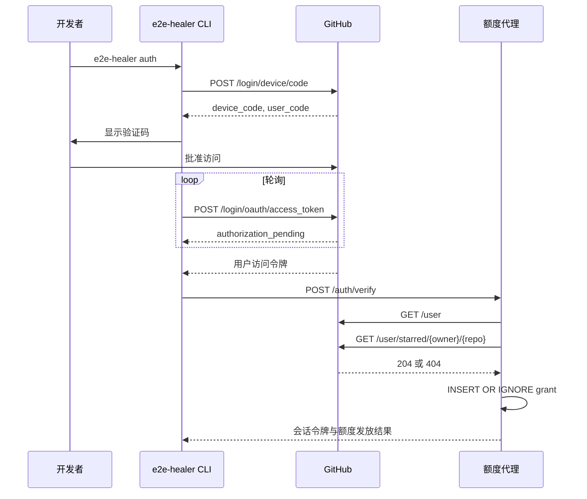

<a id="rfc-0139-free-token-event--github-star-credit-proxy-architecture"></a>

# RFC 0139：免费 Token 活动与 GitHub Star 额度代理架构

| 元数据 | 内容 |
| --- | --- |
| **Issue** | https://github.com/Lee-Dongwook/E2E-Self-Heal/issues/139 |
| **状态** | 提案，第 2 次修订，已处理审查意见 |
| **里程碑** | v1.0 |
| **组件** | 托管额度代理后端与 CLI 认证入口 |

> 本文为设计提案。所列 `auth`、`credits` 命令及代理配置不代表当前 CLI 已实现这些能力。文末勾选表示提案中的设计条目，不是运行功能验收证明。

---

<a id="1-executive-summary"></a>

## 1. 概述

本 RFC 定义官方托管的额度代理：为给 `E2E-Self-Heal` 仓库点 Star 的用户提供免费模型修复额度。代理负责验证 Star、发放与记账额度、保管托管服务的模型密钥，并转发已认证用户的模型请求。

**密钥托管范围：** 代理管理的提供商密钥留在后端密钥库，不发送到 CLI。用户自行提供的 `E2E_HEALER_LLM_API_KEY` 或厂商环境变量仍受支持，保存在用户机器上；提案要求代理被禁用、无法访问或额度耗尽时，CLI 可直接使用用户密钥。

**核心原则：** 代理只是轻量托管包装层。后端不运行修复逻辑、LangGraph 或测试修复代码，核心引擎仍可完全在本地运行。

---

<a id="2-high-level-architecture"></a>

## 2. 总体架构

```text
开发者机器                           托管额度代理（SaaS）
┌──────────────────────┐             ┌─────────────────────────┐
│ e2e-healer CLI        │    HTTPS    │ 认证服务：设备流程、Star │
│ 核心引擎             │ ←────────→ │ 记账服务：发放、账本、预留│
│ · LangGraph 循环     │             │ 模型代理：密钥库、转发   │
│ · Playwright 执行    │             └────────────┬────────────┘
│ · 补丁与验证         │                          │
│ · 用户密钥留在本地   │                          ▼
└──────────────────────┘             模型服务：OpenAI／Anthropic／NVIDIA
```

---

<a id="3-star-verification-authentication"></a>

## 3. Star 验证与身份认证

<a id="31-github-device-flow"></a>

### 3.1 GitHub 设备授权流程



Star 校验使用用户授权的 GitHub 令牌，验证完成后立即丢弃。

---

<a id="4-credit-accounting"></a>

## 4. 额度记账

<a id="database-model"></a>

### 数据库模型

```text
users
grants
reservations
credits_ledger
llm_usage
```

依次表示用户、额度发放、预留、额度账本和模型用量。

<a id="rules"></a>

### 规则

- 每个 GitHub 账户获得一次额度。
- 额度在 **30 天**后过期。
- 按发放先后顺序消耗，采用 FIFO。
- `UNIQUE(github_id, request_id)` 保证幂等。
- 同一请求标识对应的载荷哈希不一致时返回 **409 Conflict**。

<a id="reservation-lifecycle"></a>

### 预留额度生命周期

```text
reserved（已预留）
    │
    ├── committed（已结算）
    ├── released（已释放）
    └── expired（已过期）
```

有效期 TTL 为 **15 分钟**。后台对账任务释放过期预留、处理崩溃中断的请求，并防止提供商重复计费。

---

<a id="5-provider-keys"></a>

## 5. 提供商密钥

托管密钥只保存在密钥库，不发送给 CLI，每 90 天轮换。

用户密钥保留在用户机器，不上传；代理不可用时按提案自动改用用户密钥。

---

<a id="6-abuse-prevention"></a>

## 6. 防滥用措施

| 威胁 | 缓解措施 |
| --- | --- |
| 多账户刷额度 | 每个 GitHub 账户只发放一次 |
| 重放请求 | request_id 加载荷哈希 |
| 拒绝服务攻击 | 速率限制 |
| 令牌被盗 | 会话有效期 1 小时 |
| 请求体过大 | 50 KB 限制 |
| 支出失控 | 预算熔断 |

---

<a id="7-data-retention"></a>

## 7. 数据保留

默认不记录载荷日志，只在内存中转发并保存元数据。

可选调试模式使用加密存储，保留 7 天后自动删除。

---

<a id="8-cli"></a>

## 8. CLI 入口

<a id="commands"></a>

### 命令

拟议命令：

```bash
e2e-healer auth
e2e-healer credits
```

拟议配置：

```bash
E2E_HEALER_PROXY_URL
E2E_HEALER_PROXY_TOKEN
```

---

<a id="9-responsibility-split"></a>

## 9. 职责划分

| 职责 | CLI | 代理 |
| --- | --- | --- |
| LangGraph 执行 | ✅ | ❌ |
| Playwright 执行 | ✅ | ❌ |
| 用户 API 密钥 | ✅ | ❌ |
| GitHub 认证 | ❌ | ✅ |
| 额度账本 | ❌ | ✅ |
| 托管提供商密钥 | ❌ | ✅ |

---

<a id="10-open-questions"></a>

## 10. 待讨论问题

1. 是否采用跨提供商通用额度？
2. 是否支持流式响应？
3. 是否为贡献者提供奖励额度？

---

<a id="11-acceptance-criteria"></a>

## 11. 验收标准

以下保留原提案对设计项的勾选状态：

- [x] 设备授权流程
- [x] 额度记账
- [x] 防滥用措施
- [x] 后端职责边界
- [x] 优先本地运行的核心

---
