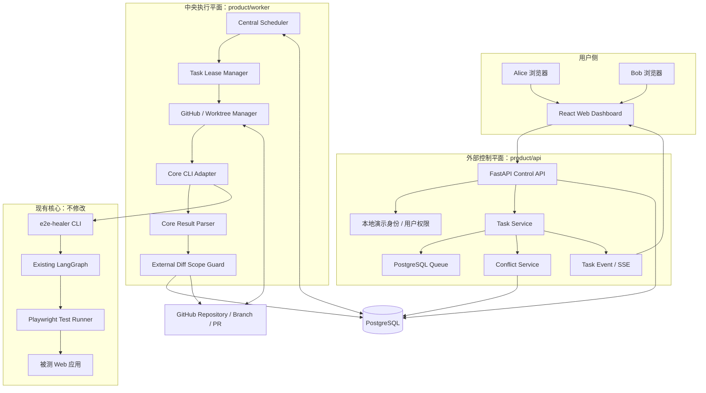
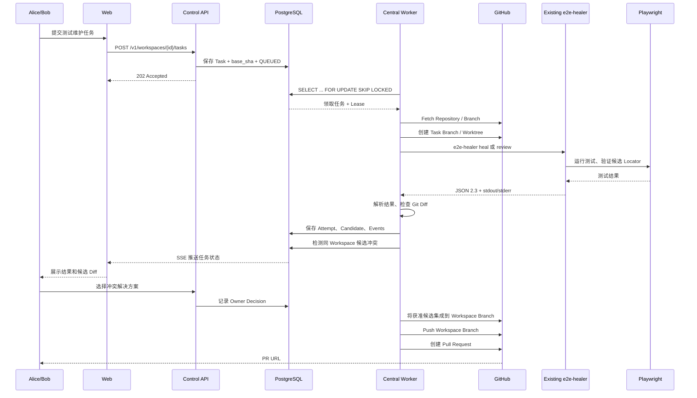
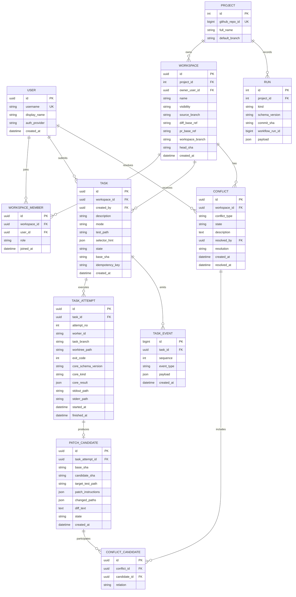
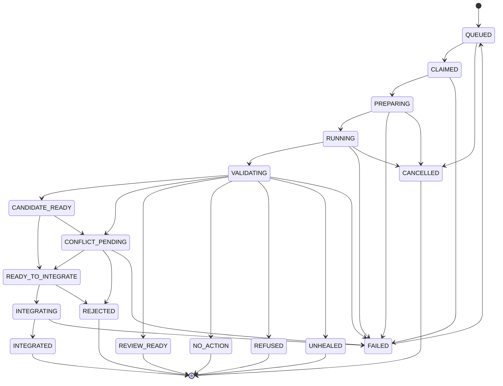
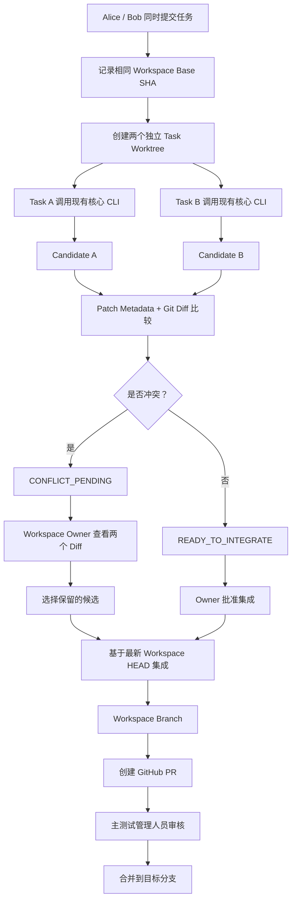

# E2E Self-Heal 外部任务管理与协作平台
## 软件架构设计文档（V1.3）

| 文档项 | 内容 |
|---|---|
| 文档版本 | V1.3 |
| 日期 | 2026-11-09 |
| 核心项目 | [zengye20040311-cmd/E2E-Self-Heal](https://github.com/zengye20040311-cmd/E2E-Self-Heal) |
| 核心源码基线 | `main` 分支 |
| Worker 部署 | Central（本机中央 Worker） |
| Git 来源 | GitHub |
| Workspace 实现 | Git Branch + Git Worktree |
| 架构原则 | 外部附加平台；不修改现有 Agent 的诊断、修复、验证逻辑 |

---

# 1. 文档目的与架构结论

本文设计的是一个**附加在现有 E2E Self-Heal 核心项目之外的任务管理与多人协作平台**。它不是第二个 Agent，也不是通用代码修改 Agent。

平台解决的是现有核心引擎之外的工程管理问题：

1. 用户通过 Web 页面提交测试维护任务。
2. 多个用户可以拥有各自的个人 Workspace，也可以加入共享 Workspace。
3. 任务进入统一队列，由中央 Worker 调度。
4. Worker 为每个任务创建隔离的 Git 分支和 Worktree。
5. Worker 通过现有 CLI 调用 E2E Self-Heal。
6. 平台收集核心 Agent 的结构化结果、测试日志和候选补丁。
7. 对多人提交的候选补丁进行冲突检测和人工决策。
8. 将获准的测试代码修改集成到 Workspace 分支，最终创建 GitHub PR。
9. 只有经过 GitHub PR 审核和合并，修改才能进入主分支。

**核心 Agent 保持原样。** 新增代码只负责用户、任务、队列、Git 工作区、调用适配、冲突管理、结果展示和 PR 流程。

## 1.1 固定架构决策

| 决策项 | 最终选择 | 说明 |
|---|---|---|
| Worker 部署 | Central | V1 只部署一个中央 Worker，运行在开发者本机 |
| Git 来源 | GitHub | 从 GitHub 仓库获取目标 Playwright 项目 |
| Workspace 实现 | Branch | 每个 Workspace 对应一个长期维护分支 |
| 任务隔离 | Git Worktree | 每个 Task 在独立 Worktree 中执行 |
| 队列 | PostgreSQL | 使用数据库事务和 `FOR UPDATE SKIP LOCKED` |
| 核心 Agent 调用 | CLI Subprocess | 调用现有 `e2e-healer` 命令，不直接调用 LangGraph 内部节点 |
| 冲突检测 | Patch Metadata + Git Diff | 在候选补丁产生后检测，不在任务提交前猜测 |
| PR 管理 | GitHub PR | 不允许平台直接向主分支提交修改 |

## 1.2 产品边界

| 模块 | 负责什么 | 不负责什么 |
|---|---|---|
| 现有 E2E Self-Heal Core | 测试失败诊断、Locator/等待条件修复、选择器验证、Playwright 复测、Review 报告 | 用户管理、多人排队、Workspace 管理、跨任务冲突决策 |
| 外部 Web 平台 | 用户交互、任务提交、任务可视化、共享 Workspace、冲突审核 | 自己生成代码补丁 |
| Control API | 权限校验、任务持久化、队列管理、状态查询、冲突决策 | 执行 Playwright 或运行 LangGraph |
| Central Worker | 获取任务、创建 Worktree、调用 CLI、解析结果、提交候选分支 | 自己诊断测试失败或生成修复代码 |
| GitHub | 仓库、分支、PR、最终代码审核 | 取代平台内部的任务队列 |

---

# 2. 现有核心 Agent 源码审计

本设计以仓库当前源码为依据。以下结论是平台集成时必须遵守的接口和边界。

## 2.1 核心 Agent 的实际工作方式

核心是 Python CLI + LangGraph，不是一个接收任意自然语言并修改任意项目代码的通用 Agent。

现有主要入口：

- `e2e-healer heal`：修复失败的 Playwright 测试。
- `e2e-healer review`：分析失败并生成源代码层面的建议，不修改文件。
- CLI 还支持 `--root`、`--log`、`--diff`、`--diff-base`、`--dry-run`、`--json` 和 `--selector-hint` 等参数。

修复图包含以下主要节点：

```text
Memory Lookup
     |
     v
Diagnoser
     |
     v
Patch Generator
     |
     v
Selector Verifier
     |
     v
Test Runner
     |
     +---- 测试失败且仍有循环预算 ----> Diagnoser
     |
     +---- 成功或达到循环上限 -------> End / Refusal
```

实际图还包含 Decline Adjudicator 和 Refusal Finalizer，用于判断模型拒绝生成补丁的情况，并给出明确拒绝原因。

Review 模式使用独立的诊断与 Reviewer 流程，不进入 Patch Generator、Selector Verifier 和 Test Runner 的修复循环。

## 2.2 现有修复范围

核心 Agent 只允许修复：

- 失效的 Playwright Locator / Selector；
- 等待条件和等待时间相关问题。

核心 Agent 不允许：

- 修改断言；
- 修改测试流程；
- 修改业务逻辑；
- 删除失败测试；
- 通过降低断言强度来让测试通过；
- 修改被测应用的 React/Vue/HTML/CSS 或后端业务代码。

Patch Generator 的输出是结构化的 `PatchInstruction`，包含：

- `line`：目标行号；
- `original`：必须与原代码完全匹配的原始行；
- `replacement`：替换后的单行代码；
- `reason`：修改理由；
- `selector`：用于实时 DOM 验证的选择器。

核心还通过代码范围检查和 AST Lock 限制补丁范围。AST Lock 对超出 Locator、超时参数和等待方法范围的结构性修改采取拒绝策略。

因此，外部平台不需要再开发一个“Agent Patch Safety”节点。它只需要在核心 Agent 运行结束后进行一次独立的 Git Diff 范围复核，作为额外防线。

## 2.3 Heal 模式和 Review 模式

| 模式 | 核心行为 | 是否修改文件 | 平台处理方式 |
|---|---|---:|---|
| `heal` | 诊断失败，生成受限补丁，验证 Locator，重新运行测试 | 成功时只修改目标测试文件 | 保存候选补丁，进行冲突检测 |
| `review` | 诊断失败，生成源代码层面的建议 | 否 | 展示 ReviewFinding，不生成代码提交 |

Review 模式的 `ReviewFinding` 可以包含被测应用的源文件、行号、失败 Locator、根因、建议和推荐选择器。这些只是**建议**，平台不得将其转换为自动修改应用代码的 Patch。

## 2.4 核心沙箱与文件权限

核心已有沙箱策略：

- 默认写入范围是 Playwright 测试文件，例如 `*.spec.ts`、`*.test.ts` 等。
- 默认禁止写入 `.env`、`.git/`、`.github/`、`node_modules/`、`.venv/` 和锁文件等。
- 严格模式下，读写路径必须位于配置的 Workspace Root 内。
- 修复失败、使用 `--dry-run` 或发生异常时，核心会恢复目标测试文件原内容。
- 选择器验证辅助文件使用唯一临时文件名，避免并发运行时互相覆盖。

平台必须将核心运行环境设为 `strict`，并确保任务 Worktree 位于配置的沙箱根目录内。

## 2.5 核心 JSON 结果契约

当前核心机器可读结果契约版本为 `2.3`，主要结果类型如下：

| `kind` | 结构 | 含义 |
|---|---|---|
| `repair` | `RepairSummary` | 生成并验证了修复结果，或修复验证失败 |
| `refusal` | `RefusalReport` | 核心拒绝修复，并提供拒绝原因和证据 |
| `suite` | `SuiteSummary` | 整个测试套件的聚合结果 |
| `review` | `ReviewReport` | 只读 Review 结果 |

`EvidenceBundle` 还包含候选补丁、循环历史、Graph 执行路径、循环预算和模型提供方来源等信息。平台应保存原始 JSON，不应只保留一个成功/失败布尔值。

## 2.6 现有 product 层的实际状态

仓库中已经存在：

- `product/api`：FastAPI；
- `product/web`：React + Vite；
- `product/docker-compose.yml`：PostgreSQL 16 和 API 的本地基础设施。

但当前它们还不是任务调度平台：

- `product/api` 当前提供 `/healthz`、`/version` 和 `/v1/runs`。
- `/v1/runs` 是 CI 结果上报接口，不是任务队列。
- 当前 `require_upload_auth()` 仍然拒绝上传并返回 HTTP 403，OIDC 上传认证尚未完成。
- `product/web/src/App.tsx` 当前只展示 API 和数据库健康状态以及版本信息，不是任务管理界面。
- 当前 Product API 明确不执行 Playwright 或修复逻辑，只接收核心 Agent 已经产生的结构化结果。

**架构选择：复用 `product` 作为外部产品层的代码位置，但将 Worker 作为独立进程。** 保留现有 `/v1/runs` CI 遥测接口，不把它误用为任务队列。

## 2.7 源码参考

| 文件 | 本设计采用的源码事实 |
|---|---|
| [README.zh-CN.md](https://github.com/zengye20040311-cmd/E2E-Self-Heal/blob/main/README.zh-CN.md) | 核心能力、CLI 使用方式、修复边界 |
| [app/cli.py](https://github.com/zengye20040311-cmd/E2E-Self-Heal/blob/main/app/cli.py) | `heal`、`review`、`--json`、`--selector-hint`、退出码 |
| [app/graph.py](https://github.com/zengye20040311-cmd/E2E-Self-Heal/blob/main/app/graph.py) | LangGraph 节点与路由 |
| [app/schemas.py](https://github.com/zengye20040311-cmd/E2E-Self-Heal/blob/main/app/schemas.py) | PatchInstruction、SelectorHint、结果契约 2.3 |
| [app/nodes/patch_generator.py](https://github.com/zengye20040311-cmd/E2E-Self-Heal/blob/main/app/nodes/patch_generator.py) | Locator/等待条件范围检查与 AST Lock |
| [app/nodes/selector_verifier.py](https://github.com/zengye20040311-cmd/E2E-Self-Heal/blob/main/app/nodes/selector_verifier.py) | 候选 Locator 的 DOM 匹配验证 |
| [app/nodes/test_runner.py](https://github.com/zengye20040311-cmd/E2E-Self-Heal/blob/main/app/nodes/test_runner.py) | 候选测试代码写入和复测 |
| [app/runner.py](https://github.com/zengye20040311-cmd/E2E-Self-Heal/blob/main/app/runner.py) | Playwright 子进程、超时与进程树清理 |
| [app/sandbox.py](https://github.com/zengye20040311-cmd/E2E-Self-Heal/blob/main/app/sandbox.py) | 文件路径和命令权限 |
| [app/healing_history.py](https://github.com/zengye20040311-cmd/E2E-Self-Heal/blob/main/app/healing_history.py) | 项目级已验证修复历史 |
| [docs/sandbox.md](https://github.com/zengye20040311-cmd/E2E-Self-Heal/blob/main/docs/sandbox.md) | 沙箱设计和默认权限 |
| [product/api/main.py](https://github.com/zengye20040311-cmd/E2E-Self-Heal/blob/main/product/api/src/product_api/main.py) | 当前 Product API 的职责 |
| [product/api/ingest.py](https://github.com/zengye20040311-cmd/E2E-Self-Heal/blob/main/product/api/src/product_api/ingest.py) | CI 结果上报与当前认证状态 |
| [product/web/src/App.tsx](https://github.com/zengye20040311-cmd/E2E-Self-Heal/blob/main/product/web/src/App.tsx) | 当前 Web 页面仅为健康检查页 |

---

# 3. 产品范围与任务输入约束

## 3.1 V1 目标功能

1. 本机运行一个可视化 Web 平台。
2. 可以模拟 Alice、Bob 两个用户。
3. 支持个人 Workspace 和共享 Workspace。
4. 用户提交测试维护任务，任务进入可视化队列。
5. 中央 Worker 逐个领取任务。
6. 每个任务在独立 Git 分支和 Worktree 中调用现有核心 CLI。
7. 展示 Agent 执行状态、日志、JSON 证据和候选 Diff。
8. 检测两个用户对同一测试目标产生的不同候选补丁。
9. Workspace Owner 可以选择保留哪个候选。
10. 将审核通过的候选补丁集成到 Workspace 分支。
11. 从 Workspace 分支创建 GitHub PR，最终由人工审核合并。

## 3.2 明确不做的功能

- 不开发第二个 Agent。
- 不新增 LangGraph 节点。
- 不修改现有 Prompt。
- 不修改核心 CLI 的行为。
- 不让 Agent 修改被测应用代码。
- 不让 Agent 修改断言、业务逻辑或测试流程。
- 不允许用户通过自然语言要求 Agent 任意编辑仓库文件。
- 不直接向 GitHub 主分支 Push。
- V1 不建设云端 Worker 集群。
- V1 不建设复杂的多 Agent 协作和动态资源调度。

## 3.3 自然语言任务的真实含义

现有核心 CLI 没有通用的自然语言任务参数。它不能直接理解：

> “把登录页面改成新的设计，并顺便调整相关测试。”

这类任务属于应用开发，不属于现有 Agent 的能力范围。

平台中的任务描述应拆分为两类信息：

| 字段 | 作用 | 是否传入核心 Agent |
|---|---|---:|
| `description` | 用户自然语言描述，用于展示、审计和协作沟通 | 否 |
| `mode` | `heal` 或 `review` | 转换为 CLI 子命令 |
| `test_path` | 目标 Playwright 测试文件 | 是 |
| `selector_hint` | 可选的结构化定位提示 | 转换为 `--selector-hint` |
| `diff_base_ref` | 用于分析 DOM 变化的 Git 基准 | 转换为 `--diff-base` |
| `app_url` | 可选的实时 DOM 验证地址 | 转换为 `--app-url` 或环境变量 |

V1 提交任务时必须明确选择 `mode` 和 `test_path`。自然语言描述用于表达人的意图，但不作为任意代码修改指令传入 Agent。

如果未来要求用户只输入一句自然语言，系统自动识别测试目标、失败类型和 CLI 参数，那属于新的任务规划能力，应另行立项；不属于本版本。

## 3.4 现有 SelectorHint 可用于最小冲突演示

核心已有 `SelectorHint`：

```json
{
  "type": "role",
  "value": "button[name=\"登录\"]",
  "original": "#login-btn",
  "confidence": 1.0
}
```

`type` 支持：

- `role`
- `testid`
- `text`
- `css`

因此，两个用户可以对同一个失败 Locator 提交不同的结构化偏好，而不需要修改核心 Agent。

---

# 4. 总体系统架构

## 4.1 组件图



## 4.2 组件职责

| 组件 | 位置 | 职责 |
|---|---|---|
| Web Dashboard | `product/web` | 用户登录、项目列表、Workspace、任务队列、日志、Diff、冲突审核 |
| Control API | `product/api` | 用户权限、项目、Workspace、任务、冲突、SSE API |
| PostgreSQL | 本地 Docker | 保存用户、Workspace、任务、执行记录、事件和候选补丁 |
| Central Scheduler | `product/worker` | 从数据库领取任务、管理并发和租约 |
| Git Workspace Manager | `product/worker` | Clone/Fetch、创建分支、创建 Worktree、Commit、清理 |
| Core CLI Adapter | `product/worker` | 通过子进程调用现有 `e2e-healer` |
| Result Parser | `product/worker` | 校验 JSON 契约版本和 `kind`，解析结构化结果 |
| External Diff Guard | `product/worker` | 检查候选分支是否只修改目标测试文件 |
| Conflict Detector | `product/api` 或共享 Service | 比较候选补丁的目标和实际修改 |
| GitHub PR Service | `product/worker` | 推送已批准的 Workspace 分支并创建 PR |

**重要：API 不执行 Agent。** API 负责接收任务和持久化状态；Worker 是独立进程，负责调用现有 CLI。

## 4.3 本机部署拓扑

V1 不需要真正的云端 Agent，也不需要多台 Worker：

```text
本机
├── Browser
│   ├── Alice Session
│   └── Bob Session
│
├── product/web       React + Vite
├── product/api       FastAPI
├── PostgreSQL        Docker Compose
├── product/worker    单个中央 Worker 进程
│
└── Workspace Storage
    ├── project-1.git
    ├── workspace-1/
    └── workspace-2/
```

另一台电脑可以通过浏览器访问 Web 平台提交任务；V1 不要求在那台电脑上部署 Worker。

如果以后需要远程执行，可以在另一台机器上安装现有 E2E Self-Heal，并部署兼容的 Remote Worker，但这不属于当前 Central 部署版本。

---

# 5. Workspace 与 Git 分支设计

## 5.1 Workspace 类型

平台支持两种 Workspace：

| 类型 | 所属关系 | 代码隔离 | 适用场景 |
|---|---|---|---|
| Personal Workspace | 单个用户 | 独立 Workspace 分支 | 每个测试人员独立维护测试代码 |
| Shared Workspace | 多个成员 | 所有成员共享同一 Workspace 分支 | 团队共同维护测试代码 |

Workspace 角色：

- `owner`：创建 Workspace、邀请成员、处理冲突、批准集成。
- `editor`：提交任务、查看结果、提出候选补丁。
- `viewer`：只读查看任务、日志和 Diff。

## 5.2 Branch + Worktree 两层结构

Workspace 对应一个长期存在的集成分支；每个任务使用独立的临时任务分支。

```text
GitHub Repository
│
├── main
│
├── e2e-self-heal/ws-001       Workspace Branch
│   │
│   ├── task branch A          Task A Candidate
│   ├── task branch B          Task B Candidate
│   └── task branch C          Task C Candidate
│
└── Pull Request
    └── ws-001 -> configured PR base
```

建议命名：

```text
Workspace Branch:
e2e-self-heal/workspace-<workspace_id>

Task Branch:
e2e-self-heal/task-<task_id>
```

每个 Task Branch 都从**提交任务时记录的 Workspace HEAD SHA** 创建，而不是从 Worker 实际执行时的最新 HEAD 创建。

## 5.3 为什么任务必须保存 Base SHA

假设 Alice 和 Bob 几乎同时提交任务：

```text
Workspace HEAD = H0

Alice 提交 Task A -> base_sha = H0
Bob   提交 Task B -> base_sha = H0
```

即使 Worker 只有一个、任务串行执行，仍然应该：

```text
Task A Worktree：从 H0 创建
Task B Worktree：也从 H0 创建
```

这样两个任务可以独立生成候选补丁。

如果 Bob 的任务等到 Alice 的补丁集成后才创建 Worktree，那么 Bob 可能看到测试已经通过，核心 Agent 不再生成第二个候选补丁。这样就无法验证“两个人基于相同问题提出不同修复方案”的冲突场景。

所以：

- 任务提交时保存 `base_sha`。
- Worker 创建 Task Branch 时使用该 SHA。
- 候选补丁生成后，平台再比较候选与 Workspace 当前 HEAD。
- 冲突解决后，才将候选集成到 Workspace Branch。

## 5.4 代码路径布局

建议使用：

```text
data/
├── repositories/
│   └── <project_id>.git/
│
└── workspaces/
    └── <workspace_id>/
        ├── workspace.json
        ├── memory/
        │   └── healing-history.json
        └── worktrees/
            ├── <task_id_A>/
            ├── <task_id_B>/
            └── <task_id_C>/
```

每个 Task Worktree 都是独立 Git 工作目录。

核心 Agent 的项目级修复历史位于 `.e2e-healer/healing-history.json`。由于每个任务有独立 Worktree，Worker 可以在运行前将 Workspace 的历史文件复制到任务 Worktree，运行后再将更新后的历史文件同步回 Workspace 的本地 Memory Store。

该同步由 Worker 管理，不需要修改核心 Agent。对同一 Workspace 的任务执行串行化，避免历史文件出现并发写入。

修复历史和测试日志不应被 `git add -A` 意外提交。Worker 必须显式 `git add -- <target_test_path>`。

## 5.5 三种 Git 引用必须分开

Workspace 至少需要保存以下三个引用：

| 字段 | 含义 | 用途 |
|---|---|---|
| `source_branch` | 被测项目当前要运行测试的分支 | 创建 Workspace 的初始代码 |
| `diff_base_ref` | 用于比较 DOM / 源码变化的 Git 基准 | 传给核心 CLI 的 `--diff-base` |
| `pr_base_ref` | 最终 PR 的目标分支 | 创建 GitHub PR |

例如：

```text
source_branch = feature/login-redesign
diff_base_ref = origin/main
pr_base_ref = feature/login-redesign
```

这样核心 Agent 可以通过 `git diff origin/main...HEAD` 看到登录页面的变化，同时只修改 Playwright 测试文件。最终测试修复 PR 可以合并到对应的功能分支，再由原功能 PR 进入 main。

---

# 6. 任务执行与数据流

## 6.1 完整数据流



## 6.2 任务提交阶段

1. 用户选择 GitHub Project。
2. 用户选择个人或共享 Workspace。
3. 用户填写任务描述、模式和测试文件路径。
4. 如有需要，用户选择 Locator 类型并填写结构化 `selector_hint`。
5. API 检查用户是否有 `editor` 或 `owner` 权限。
6. API 读取 Workspace 当前 HEAD SHA。
7. 在同一个数据库事务中保存 Task、Base SHA 和 QUEUED 状态。
8. 返回任务 ID 和当前排队位置。

## 6.3 Worker 执行阶段

1. Worker 领取任务并创建执行租约。
2. Fetch GitHub 远端分支。
3. 根据任务保存的 `base_sha` 创建 Task Branch。
4. 创建独立 Git Worktree。
5. 准备 Playwright 运行环境。
6. 配置核心 Agent 环境变量和严格沙箱。
7. 调用现有 CLI。
8. 读取 stdout、stderr、退出码和 JSON。
9. 解析核心结果。
10. 检查候选分支的 Git Diff。
11. 保存候选补丁、证据和日志。
12. 运行冲突检测。
13. 更新任务状态并通过 SSE 推送前端。

## 6.4 候选补丁集成阶段

- 冲突任务：等待 Workspace Owner 决策。
- 无冲突任务：进入 `READY_TO_INTEGRATE`，由 Owner 批准后集成。
- 被拒绝候选：保留审计记录，不集成。
- Review 任务：只展示 ReviewFinding，不创建 Patch Commit。
- 已集成的 Workspace Branch：可以创建 GitHub PR。
- PR 是否进入主分支，完全由 GitHub 审核和分支保护规则决定。

---

# 7. Core CLI Adapter 契约

## 7.1 Heal 调用

示例：

```bash
e2e-healer heal tests/login.spec.ts \
  --json \
  --diff-base origin/main \
  --selector-hint '{"type":"role","value":"button[name=\"登录\"]","original":"#login-btn","confidence":1.0}'
```

Worker 需要：

- 将进程工作目录设置为当前 Task Worktree。
- 使用绝对路径配置 `E2E_HEALER_WORKSPACE_ROOT`。
- 设置 `E2E_HEALER_SANDBOX_MODE=strict`。
- 传入目标测试路径。
- 传入可选 `--diff-base`。
- 仅在用户提供结构化提示时传入 `--selector-hint`。
- 使用参数数组启动进程，不使用 `shell=True`。

不要把任务的 `description` 拼接到命令行或 Agent Prompt 中。

## 7.2 Review 调用

```bash
e2e-healer review tests/login.spec.ts \
  --json \
  --diff-base origin/main
```

Review 模式只输出建议，不允许 Worker 对被测应用源码进行自动写入。若未传入 `--log`，现有 CLI 会先运行目标测试以采集失败日志；这仍然是只读 Review，不代表它会修改测试文件。

## 7.3 环境变量

Worker 应根据 Project 和 Workspace 配置构建隔离环境：

```text
E2E_HEALER_LLM_PROVIDER
E2E_HEALER_LLM_API_KEY
E2E_HEALER_LLM_MODEL
E2E_HEALER_MAX_LOOPS=3
E2E_HEALER_PLAYWRIGHT_CMD=npx playwright test
E2E_HEALER_TEST_TIMEOUT_SECONDS=120
E2E_HEALER_SANDBOX_MODE=strict
E2E_HEALER_WORKSPACE_ROOT=<absolute-task-worktree>
E2E_HEALER_VERIFY_SELECTORS=true
E2E_HEALER_APP_URL=<optional>
```

LLM 密钥通过本机环境变量或 Secret 配置提供，不存储在 Task、TaskEvent 或日志中。

GitHub Token 只用于 Git 操作，不需要传给核心 Agent。Worker 应在启动核心 CLI 前从子进程环境中移除 `GH_TOKEN`、`GITHUB_TOKEN` 等 GitHub 凭证。

**安全限制：** 当前核心 Playwright 子进程继承 CLI 的进程环境，因此核心所需的 LLM API Key 可能被目标测试进程继承。V1 只允许执行用户明确授权、可信的 GitHub 仓库。不要把任意陌生仓库当成可信代码执行。若未来要支持不可信仓库，需要进一步做操作系统/容器隔离和密钥代理设计；不能仅依赖当前应用层沙箱。

## 7.4 退出码和结果解析

Worker 不应只根据退出码判断业务结果，必须结合 stdout JSON：

| CLI 结果 | Worker 分类 | 处理 |
|---|---|---|
| exit 0 + `kind=repair` + `is_success=true` | `CANDIDATE_READY` | 读取 PatchInstruction，检查 Git Diff |
| exit 0 + 无 JSON | `NO_ACTION` | 通常表示测试原本已通过，无需修复 |
| exit 1 + `kind=refusal` | `REFUSED` | 展示拒绝原因和 Evidence |
| exit 1 + `kind=suite` 且 `is_success=false` | `UNHEALED` | 保存套件失败证据，不集成；V1 单文件任务暂不开放 suite 模式 |
| exit 0 + `kind=review` + `is_complete=true` | `REVIEW_READY` | 展示 findings，不创建代码补丁 |
| exit 1 + `kind=review` 且 `is_complete=false` | `REVIEW_INCOMPLETE` | 展示 Review 失败信息 |
| exit 2 或无效 JSON/契约版本 | `FAILED` | 视为配置、沙箱或基础设施错误 |

注意：CLI 在目标测试已经通过时可能直接退出，不产生 JSON。因此，`exit 0 + 无 JSON` 必须被识别为“无需修复”，不能误判为 Worker 解析失败。

## 7.5 Core JSON 兼容性

- 当前支持 `schema_version=2.3`。
- Worker 解析时校验 `schema_version` 和 `kind`。
- 保存原始 JSON 到 `task_attempt.core_result`。
- 未知字段必须容忍，不能因为核心增加可选字段而崩溃。
- 遇到未知主版本时停止集成并报告兼容性错误。

## 7.6 外部 Diff Scope Guard

核心 Agent 自身已经有文件写入沙箱和 Patch Guardrail。外部平台再做一次独立检查：

```text
Candidate Branch Diff
       |
       v
Changed Files
       |
       +---- 仅目标测试文件 ------> 允许进入候选补丁审核
       |
       +---- 包含应用源码/后端代码 -> 拒绝候选并记录安全事件
       |
       +---- 包含配置/密钥/锁文件 -> 拒绝候选并记录安全事件
```

V1 单文件任务的允许提交路径只有：

```text
task.test_path
```

`.e2e-healer/` 修复历史、`test-results/`、日志和临时辅助文件属于运行产物，不应被加入候选 Commit。

Worker 应显式暂存目标测试文件，而不是使用 `git add -A`。

---

# 8. 数据库 ER 关系

## 8.1 ER 图



## 8.2 表说明

### `users`

V1 使用本地演示用户，预置 Alice 和 Bob。生产环境再接入 GitHub OAuth。

### `projects`

复用现有 `product_api.models.Project`，表示一个 GitHub 仓库。需要增加默认分支等元数据时，通过数据库迁移扩展。

### `workspaces`

保存分支级工作区信息。`visibility` 为 `private` 或 `shared`。

`head_sha` 表示当前 Workspace 集成分支的 HEAD。

### `workspace_members`

维护 Workspace 成员关系和角色。唯一约束：

```text
UNIQUE(workspace_id, user_id)
```

### `tasks`

保存用户提交的任务。关键字段：

- `base_sha`：任务提交时的 Workspace HEAD。
- `mode`：`heal` 或 `review`。
- `test_path`：唯一目标测试文件。
- `selector_hint`：可选的结构化定位提示。
- `idempotency_key`：避免重复提交。

唯一约束：

```text
UNIQUE(workspace_id, idempotency_key)
```

### `task_attempts`

一次 Task 可以有多次执行尝试。每次尝试对应独立的任务分支、Worktree、CLI 退出码和核心 JSON。

唯一约束：

```text
UNIQUE(task_id, attempt_no)
```

### `patch_candidates`

保存核心 Agent 成功生成并通过复测的候选补丁。候选补丁不等于已集成代码。

### `conflicts` 与 `conflict_candidates`

记录同一 Workspace 中互相冲突的候选补丁，以及参与冲突的 Candidate。

### `task_events`

追加式事件记录，供任务详情页和 SSE 实时更新使用。事件不可通过普通更新接口覆盖。

### `runs`

保留当前已有的 CI 结果上报模型。它与用户主动提交的 Task/TaskAttempt 分开，避免把 CI 遥测和平台任务混为一谈。

---

# 9. 完整 API 契约

API 前缀统一使用 `/v1`。现有 `/v1/runs` 保持原有 CI 遥测用途。

## 9.1 通用规则

- 数据格式：JSON。
- 时间：ISO 8601 UTC。
- ID：UUID，现有 `Project` 和 CI `Run` 除外。
- 认证：本地开发使用 Dev Session；生产环境使用 GitHub OAuth 或企业身份系统。
- 权限：Workspace 角色控制读写。
- 分页：`limit` + `cursor`。
- 错误：统一返回 `{"detail": "...", "code": "..."}`。
- 任务创建使用 HTTP 202。
- Task 和 TaskEvent 的创建应在数据库事务中完成。

## 9.2 本地演示认证

### `POST /v1/auth/dev-session`

仅在 `APP_ENV=development` 时开放，用于模拟双人协作。

请求：

```json
{
  "user_id": "alice"
}
```

或：

```json
{
  "user_id": "bob"
}
```

响应：

```json
{
  "user": {
    "id": "user-alice",
    "username": "alice",
    "display_name": "Alice"
  }
}
```

通过 HttpOnly Session Cookie 维持身份。生产环境必须关闭该接口。

### `DELETE /v1/auth/session`

注销当前会话。

### `GET /v1/me`

返回当前用户和可访问的 Workspace 摘要。

## 9.3 Project API

### `GET /v1/projects`

获取当前用户可访问的 GitHub Project。

### `POST /v1/projects`

请求：

```json
{
  "full_name": "owner/repository"
}
```

响应：

```json
{
  "id": 1,
  "full_name": "owner/repository",
  "default_branch": "main",
  "source": "github"
}
```

### `GET /v1/projects/{project_id}/branches`

获取仓库分支列表，用于 Workspace 创建和分支选择。

## 9.4 Workspace API

### `POST /v1/workspaces`

请求：

```json
{
  "project_id": 1,
  "name": "Login E2E Maintenance",
  "visibility": "shared",
  "source_branch": "feature/login-redesign",
  "diff_base_ref": "origin/main",
  "pr_base_ref": "feature/login-redesign"
}
```

响应：

```json
{
  "id": "ws-001",
  "name": "Login E2E Maintenance",
  "visibility": "shared",
  "workspace_branch": "e2e-self-heal/workspace-ws-001",
  "head_sha": "abc123...",
  "owner": "alice"
}
```

### `GET /v1/workspaces`

返回当前用户有权限访问的 Workspace。

### `GET /v1/workspaces/{workspace_id}`

返回 Workspace 详情、成员、分支和当前 HEAD SHA。

### `POST /v1/workspaces/{workspace_id}/members`

请求：

```json
{
  "user_id": "bob",
  "role": "editor"
}
```

只有 Owner 可以添加或修改成员。

### `GET /v1/workspaces/{workspace_id}/members`

获取成员列表和角色。

## 9.5 Task API

### `POST /v1/workspaces/{workspace_id}/tasks`

<badge>核心提交接口</badge>

请求：

```json
{
  "description": "修复登录测试中失效的登录按钮定位器，优先使用语义化 role 定位，保持原有断言和测试流程不变。",
  "mode": "heal",
  "test_path": "tests/login.spec.ts",
  "selector_hint": {
    "type": "role",
    "value": "button[name=\"登录\"]",
    "original": "#login-btn",
    "confidence": 1.0
  }
}
```

请求头：

```text
Idempotency-Key: <unique-request-key>
```

响应：HTTP 202

```json
{
  "task_id": "task-001",
  "state": "QUEUED",
  "workspace_id": "ws-001",
  "base_sha": "abc123...",
  "queue_position": 1,
  "created_at": "2026-11-09T10:00:00Z"
}
```

校验规则：

- `mode` 只能是 `heal` 或 `review`。
- `test_path` 必须是相对路径。
- 拒绝 `..`、绝对路径和路径穿越。
- V1 必须指定一个测试文件。
- `selector_hint.type` 只能是 `role`、`testid`、`text`、`css`。
- `selector_hint.original` 必须表示原失败 Locator。
- 只有 `owner` 或 `editor` 可以提交任务。

### `GET /v1/workspaces/{workspace_id}/tasks`

查询 Workspace 的任务列表。

支持：

```text
?state=QUEUED
?created_by=alice
?limit=20
?cursor=...
```

### `GET /v1/tasks/{task_id}`

返回任务详情，包括：

- 创建人；
- 自然语言描述；
- 模式和目标测试路径；
- Base SHA；
- 当前状态；
- Worker/Attempt 信息；
- Core JSON 摘要；
- 候选补丁；
- 冲突状态；
- 创建时间和完成时间。

### `POST /v1/tasks/{task_id}/cancel`

取消尚未开始或仍可安全终止的任务。已经完成的任务不可取消；正在执行的任务由 Worker 接收取消信号并清理进程树。

### `POST /v1/tasks/{task_id}/retry`

对基础设施失败或用户明确要求重试的任务创建新的 Attempt。重试时必须明确使用原始 Base SHA 还是最新 Workspace HEAD，默认使用最新 HEAD，并记录新的 `base_sha`。

## 9.6 Task 实时事件 API

### `GET /v1/tasks/{task_id}/events`

使用 Server-Sent Events：

```text
id: 1
event: task.claimed
data: {"worker_id":"central-01"}

id: 2
event: task.worktree_ready
data: {"branch":"e2e-self-heal/task-task-001"}

id: 3
event: core.started
data: {"mode":"heal"}

id: 4
event: core.finished
data: {"kind":"repair","is_success":true}

id: 5
event: conflict.detected
data: {"conflict_id":"conflict-001"}
```

前端断线重连时使用 `Last-Event-ID` 恢复事件。

## 9.7 Candidate API

### `GET /v1/tasks/{task_id}/result`

获取核心 Agent 原始 JSON 和平台解析后的摘要。

### `GET /v1/tasks/{task_id}/diff`

获取候选分支相对 Base SHA 的 Unified Diff。

### `GET /v1/workspaces/{workspace_id}/candidates`

获取 Workspace 内待审核、冲突中、已批准或已集成的候选补丁。

## 9.8 Conflict API

### `GET /v1/workspaces/{workspace_id}/conflicts`

获取 Workspace 内待处理冲突。

### `GET /v1/conflicts/{conflict_id}`

返回冲突原因、参与 Candidate、Base SHA、目标文件、重叠代码位置和候选 Diff。

### `POST /v1/conflicts/{conflict_id}/resolve`

请求：

```json
{
  "decision": "accept_candidate",
  "chosen_candidate_id": "candidate-a",
  "expected_workspace_head_sha": "abc123..."
}
```

`decision` 支持：

- `accept_candidate`：采用指定候选；
- `reject_candidate`：拒绝冲突候选；
- `retry_on_latest`：基于最新 Workspace HEAD 重新执行任务。

响应：

```json
{
  "conflict_id": "conflict-001",
  "state": "RESOLVED",
  "chosen_candidate_id": "candidate-a",
  "workspace_head_sha": "def456..."
}
```

必须校验 `expected_workspace_head_sha`。若 Workspace HEAD 已变化，返回 HTTP 409，要求前端刷新冲突详情。

只有 Workspace Owner 可以解决冲突。

## 9.9 GitHub PR API

### `POST /v1/workspaces/{workspace_id}/pull-requests`

请求：

```json
{
  "title": "test: repair login E2E locator",
  "body": "Contains reviewed E2E test-only repairs."
}
```

响应：

```json
{
  "pull_request_url": "https://github.com/owner/repository/pull/123",
  "head_branch": "e2e-self-heal/workspace-ws-001",
  "base_branch": "feature/login-redesign"
}
```

只有 Workspace Owner 可以创建 PR。

平台不得提供直接合并到 main 的 API。

## 9.10 API 错误码

| HTTP | code | 含义 |
|---:|---|---|
| 400 | `INVALID_REQUEST` | 请求参数格式错误 |
| 401 | `UNAUTHENTICATED` | 未登录 |
| 403 | `WORKSPACE_FORBIDDEN` | 无 Workspace 权限 |
| 404 | `RESOURCE_NOT_FOUND` | Project、Workspace、Task 或 Conflict 不存在 |
| 409 | `STALE_WORKSPACE_HEAD` | Workspace HEAD 已变化 |
| 409 | `TASK_ALREADY_RUNNING` | 当前任务状态不允许操作 |
| 409 | `IDEMPOTENCY_CONFLICT` | 幂等键重复但请求内容不同 |
| 422 | `INVALID_TEST_TARGET` | 测试路径不符合规则 |
| 422 | `UNSUPPORTED_CORE_SCHEMA` | 核心结果契约版本不支持 |
| 500 | `INTERNAL_ERROR` | 平台内部异常 |
| 503 | `WORKER_UNAVAILABLE` | 没有可用 Worker |

---

# 10. Task 状态机

## 10.1 状态定义

| 状态 | 含义 |
|---|---|
| `QUEUED` | 已提交，等待 Worker |
| `CLAIMED` | 已被 Worker 领取 |
| `PREPARING` | 正在 Fetch、创建分支和 Worktree |
| `RUNNING` | 正在执行核心 CLI |
| `VALIDATING` | 解析 JSON、检查 Git Diff 和候选补丁 |
| `CANDIDATE_READY` | 生成了可审核候选补丁 |
| `CONFLICT_PENDING` | 候选补丁与其他任务冲突 |
| `READY_TO_INTEGRATE` | 无冲突或冲突已解决，等待 Owner 批准集成 |
| `INTEGRATING` | 正在将候选集成到 Workspace Branch |
| `INTEGRATED` | 候选已集成到 Workspace Branch |
| `REVIEW_READY` | Review 模式生成了建议 |
| `NO_ACTION` | 测试原本已通过，无需修复 |
| `REFUSED` | 核心 Agent 根据证据拒绝修复 |
| `UNHEALED` | 修复循环执行完毕，但未得到成功结果 |
| `FAILED` | Worker、Git、CLI 配置或基础设施失败 |
| `CANCELLED` | 用户取消任务 |
| `REJECTED` | 候选补丁被 Owner 拒绝 |

## 10.2 状态转移图



## 10.3 状态机约束

1. 只有 `QUEUED` 可以被 Worker 正常领取。
2. `CLAIMED`、`PREPARING`、`RUNNING` 必须有有效 Lease。
3. `VALIDATING` 之前不允许创建 Candidate。
4. `REVIEW_READY` 不允许产生 Patch Candidate。
5. `REFUSED`、`UNHEALED`、`NO_ACTION` 不允许进入集成流程。
6. `CONFLICT_PENDING` 必须有 Conflict 记录。
7. `INTEGRATED` 必须保存集成 Commit SHA。
8. `INTEGRATED` 不代表进入 main，只代表进入 Workspace Branch。
9. GitHub PR 的合并状态单独记录，不与 Task 状态混用。

---

# 11. 并发控制与冲突解决方案

这是本项目最重要的外部平台能力。

## 11.1 并发问题分为三个层次

| 层次 | 问题 | 解决方式 |
|---|---|---|
| 任务并发 | 多人同时提交任务，Worker 如何领取 | PostgreSQL Queue + Lease |
| 文件并发 | 多个任务同时修改同一个 Workspace 文件 | Task Worktree 隔离 + Workspace 集成锁 |
| 意图并发 | 两个人对同一 Locator 提出不同修复方案 | 候选补丁生成后进行目标级冲突检测 |

不能只依赖 Git Merge Conflict。

例如：

```python
# Alice 的候选
page.getByRole("button", {name: "登录"}).click()

# Bob 的候选
page.getByTestId("login-button").click()
```

两段代码在 Git 层面可能表现为同一行替换冲突，但更重要的是它们代表了两个用户对同一测试目标的不同维护意图。

## 11.2 任务队列锁

V1 只部署一个 Central Worker，但仍然实现数据库租约，避免未来扩展时重写调度器。

领取任务使用事务：

```sql
BEGIN;

SELECT id
FROM tasks
WHERE state = 'QUEUED'
ORDER BY priority DESC, created_at ASC
FOR UPDATE SKIP LOCKED
LIMIT 1;

UPDATE tasks
SET state = 'CLAIMED',
    lease_owner = :worker_id,
    lease_expires_at = NOW() + INTERVAL '60 seconds',
    heartbeat_at = NOW()
WHERE id = :task_id;

COMMIT;
```

Worker 每隔固定时间更新心跳。

如果 Worker 崩溃：

- Lease 过期；
- Scheduler 检测到任务失去执行者；
- 将任务标记为可重试；
- 创建新的 Attempt；
- 不复用可能处于脏状态的旧 Worktree。

## 11.3 Workspace 级锁

同一 Workspace 的集成操作必须串行化。

V1 建议：

```text
全局 Worker 并发数 = 1
每个 Workspace 同时只能有 1 个 Integration
每个 Task 有独立 Worktree
```

这样实现简单，并且足以模拟多人并发。

后续即使增加多个 Worker，也必须保留 Workspace 级集成锁。

## 11.4 不在提交前预测冲突

用户提交的是自然语言任务，平台无法准确预知 Agent 最终会修改哪一行代码。

因此任务创建阶段只记录：

- Workspace；
- Base SHA；
- 测试路径；
- 模式；
- 用户提供的结构化提示。

**不在提交阶段做语义冲突结论。**

真正的冲突检测发生在核心 Agent 已经生成候选补丁、平台取得 PatchInstruction 和 Git Diff 之后。

## 11.5 确定性冲突规则

V1 使用规则式冲突检测，不需要再调用 LLM。

### 规则 A：同一测试文件、同一原始行、不同替换

满足：

```text
candidate_A.target_test_path == candidate_B.target_test_path
candidate_A.instruction.original == candidate_B.instruction.original
candidate_A.instruction.line == candidate_B.instruction.line
candidate_A.instruction.replacement != candidate_B.instruction.replacement
```

判定：

```text
SEMANTIC_TARGET_CONFLICT
```

### 规则 B：同一测试文件、修改区间重叠

如果两个候选补丁修改同一个文件的重叠代码区间，判定：

```text
OVERLAPPING_PATCH_CONFLICT
```

### 规则 C：Git 三方合并失败

即使 PatchInstruction 不重叠，如果 Git 合并失败，也判定：

```text
GIT_MERGE_CONFLICT
```

### 规则 D：候选补丁完全相同

如果目标和替换内容完全相同：

```text
EQUIVALENT_CANDIDATE
```

可以提示重复候选，不需要让用户重复解决。

### 规则 E：修改不同测试文件

如果两个候选修改不同文件且 Git 三方合并成功：

```text
NO_CONFLICT
```

仍需 Workspace Owner 批准集成。

## 11.6 集成时的乐观锁

冲突解决期间 Workspace HEAD 可能发生变化。

Owner 提交决策时必须带上：

```json
{
  "expected_workspace_head_sha": "abc123..."
}
```

集成前重新读取 Workspace HEAD：

- 与预期 SHA 一致：继续集成。
- 与预期 SHA 不一致：返回 409，重新计算合并关系。
- Git Push 被远端拒绝：Fetch 最新分支，再检查候选是否仍然适用。
- 不允许无条件 Force Push 覆盖其他人的修改。

## 11.7 双人冲突处理流程



---

# 12. 双人冲突最小演示案例

本案例是 V1 必须完成的核心验收场景。

## 12.1 初始测试代码

假设原始测试：

```typescript
test("user can login", async ({ page }) => {
  await page.goto("/login");

  await page.locator("#login-btn").click();

  await expect(page.getByText("欢迎回来")).toBeVisible();
});
```

被测页面发生了 UI 标识变化，导致 `#login-btn` 失效，但登录业务行为和原断言仍然有效。

## 12.2 Alice 提交任务

自然语言描述：

> 修复登录测试中的失效定位器，优先使用语义化 role 定位，保持原有测试流程和断言不变。

结构化提示：

```json
{
  "type": "role",
  "value": "button[name=\"登录\"]",
  "original": "#login-btn",
  "confidence": 1.0
}
```

CLI Adapter 将其转换为已有 `--selector-hint` 参数。

## 12.3 Bob 提交任务

自然语言描述：

> 修复同一个登录按钮定位器，优先使用 data-testid，保持原有测试流程和断言不变。

结构化提示：

```json
{
  "type": "testid",
  "value": "login-button",
  "original": "#login-btn",
  "confidence": 1.0
}
```

## 12.4 两个任务的执行

两个任务提交时都记录：

```text
workspace_id = ws-001
base_sha = H0
test_path = tests/login.spec.ts
```

Worker 只有一个，也可以按顺序执行：

```text
Task A:
  branch = e2e-self-heal/task-A
  worktree = worktrees/task-A
  base = H0

Task B:
  branch = e2e-self-heal/task-B
  worktree = worktrees/task-B
  base = H0
```

两个 Worktree 完全隔离，不会互相覆盖。

## 12.5 两个候选补丁

Alice：

```typescript
await page.getByRole("button", { name: "登录" }).click();
```

Bob：

```typescript
await page.getByTestId("login-button").click();
```

两者都只修改测试代码中的 Locator，且必须由现有核心 Agent 完成实际修复和复测。

## 12.6 平台检测冲突

平台读取核心输出中的 PatchInstruction：

```text
Candidate A:
  file = tests/login.spec.ts
  original = page.locator("#login-btn").click();
  replacement = page.getByRole(...).click();

Candidate B:
  file = tests/login.spec.ts
  original = page.locator("#login-btn").click();
  replacement = page.getByTestId(...).click();
```

满足：

- 同一个 Workspace；
- 同一个 Base SHA；
- 同一个测试文件；
- 同一个原始代码行；
- 不同替换内容。

平台创建 Conflict：

```json
{
  "conflict_type": "SEMANTIC_TARGET_CONFLICT",
  "target_test_path": "tests/login.spec.ts",
  "base_sha": "H0",
  "candidate_ids": [
    "candidate-A",
    "candidate-B"
  ],
  "state": "PENDING"
}
```

## 12.7 Owner 决策

Workspace Owner 可以：

1. 选择 Alice 的方案；
2. 选择 Bob 的方案；
3. 拒绝两者，要求重新执行；
4. 查看两者证据后自行选择符合项目规范的方案。

假设选择 Alice：

- 将 Candidate A 集成到 Workspace Branch。
- Candidate B 标记为 `SUPERSEDED` 或 `REJECTED`。
- 保留两个候选的完整审计记录。
- 不修改被测应用代码。
- 不直接进入 main。
- 最终创建 GitHub PR。

**演示前提：Alice 和 Bob 必须在第一个候选被集成之前提交任务。** 这样两者才能基于相同的失败版本独立生成候选补丁。如果 Bob 在 Alice 的修改已经集成后才提交，测试可能已经通过，核心 Agent 正确地会返回无需修复；这不属于冲突检测失败。

---

# 13. 安全与权限设计

## 13.1 核心修改边界

| 对象 | 平台权限 |
|---|---|
| Playwright 测试文件 | 通过现有核心 Agent 在安全范围内修改 |
| 测试断言 | 不允许 Agent 修改 |
| 测试流程 | 不允许 Agent 修改 |
| React/Vue/HTML/CSS | 只读分析 |
| 后端业务代码 | 只读分析 |
| API 业务逻辑 | 只读分析 |
| GitHub main | 不允许直接 Push |
| Workspace Branch | 通过审核后的候选补丁集成 |

## 13.2 角色权限

| 操作 | Owner | Editor | Viewer |
|---|---:|---:|---:|
| 查看 Workspace | 是 | 是 | 是 |
| 提交任务 | 是 | 是 | 否 |
| 查看日志和 Diff | 是 | 是 | 是 |
| 邀请成员 | 是 | 否 | 否 |
| 处理冲突 | 是 | 否 | 否 |
| 批准候选集成 | 是 | 可选策略 | 否 |
| 创建 PR | 是 | 可选策略 | 否 |

## 13.3 GitHub 凭证

- V1 本地演示可使用本机环境变量中的 GitHub Token。
- Token 不写入数据库。
- Token 不写入任务日志。
- Token 不传给核心 Agent 或 Playwright 子进程。
- Git 操作结束后清理临时凭证。
- 生产版本使用 GitHub App 或 OAuth，按仓库授权。

## 13.4 任务审计

每次任务至少记录：

- 谁提交；
- 提交时间；
- Workspace；
- Base SHA；
- CLI 模式；
- CLI 版本和 Schema 版本；
- Worker ID；
- 执行开始和结束时间；
- 退出码；
- 核心 JSON；
- 候选 Diff；
- 冲突检测结果；
- Owner 决策；
- 集成 Commit SHA；
- GitHub PR URL。

---

# 14. 推荐目录结构

在不修改 `app/` 核心 Agent 的前提下，扩展现有 `product/`。

```text
E2E-Self-Heal/
│
├── app/                         # 现有核心 Agent：V1 不修改
│   ├── cli.py
│   ├── graph.py
│   ├── schemas.py
│   ├── nodes/
│   ├── preprocess/
│   ├── verify/
│   └── sandbox.py
│
├── tests/                       # 现有核心测试：不因平台需求改动
│
├── product/
│   │
│   ├── api/
│   │   └── src/product_api/
│   │       ├── main.py
│   │       ├── config.py
│   │       ├── db.py
│   │       ├── models.py         # 扩展用户、Workspace、Task 等模型
│   │       ├── schemas.py
│   │       ├── dependencies.py
│   │       ├── auth/
│   │       │   ├── dev_session.py
│   │       │   └── permissions.py
│   │       ├── routes/
│   │       │   ├── projects.py
│   │       │   ├── workspaces.py
│   │       │   ├── tasks.py
│   │       │   ├── conflicts.py
│   │       │   ├── events.py
│   │       │   └── pull_requests.py
│   │       └── services/
│   │           ├── task_service.py
│   │           ├── queue_service.py
│   │           ├── conflict_service.py
│   │           └── event_service.py
│   │
│   ├── worker/
│   │   ├── pyproject.toml
│   │   └── src/product_worker/
│   │       ├── main.py
│   │       ├── scheduler.py
│   │       ├── lease_manager.py
│   │       ├── workspace_manager.py
│   │       ├── git_service.py
│   │       ├── core_cli_adapter.py
│   │       ├── result_parser.py
│   │       ├── diff_guard.py
│   │       ├── conflict_detector.py
│   │       ├── integration_service.py
│   │       ├── github_pr_service.py
│   │       └── event_publisher.py
│   │
│   ├── web/
│   │   └── src/
│   │       ├── App.tsx
│   │       ├── api/
│   │       ├── auth/
│   │       ├── pages/
│   │       │   ├── Dashboard.tsx
│   │       │   ├── Projects.tsx
│   │       │   ├── WorkspaceDetail.tsx
│   │       │   ├── TaskDetail.tsx
│   │       │   └── ConflictReview.tsx
│   │       ├── components/
│   │       │   ├── TaskQueue.tsx
│   │       │   ├── TaskStatus.tsx
│   │       │   ├── DiffViewer.tsx
│   │       │   ├── EventTimeline.tsx
│   │       │   └── ConflictCompare.tsx
│   │       └── hooks/
│   │           ├── useTaskEvents.ts
│   │           └── useWorkspace.ts
│   │
│   ├── migrations/
│   └── docker-compose.yml
│
├── docs/
│   └── external-platform-architecture-v1.3.md
│
└── README.md
```

目录原则：

- `app/`：现有核心 Agent，不增加平台调度职责。
- `product/api/`：外部控制平面。
- `product/worker/`：独立中央执行进程。
- `product/web/`：可视化平台。
- `product/migrations/`：平台数据库迁移。
- `data/`：运行时 Workspace 和 Worktree，不提交到 Git。

---

# 15. 分阶段编码清单

建议先完成真实 CLI 集成，再开发完整前端，避免出现“平台能排队，但不能可靠调用 Agent”的情况。

## Phase 0：核心 CLI Adapter 验证

目标：确认外部 Worker 能不修改核心源码地调用现有 Agent。

任务：

1. 创建一个临时 Git 仓库作为目标 Playwright 项目。
2. 安装现有 E2E Self-Heal CLI。
3. 创建一个可复现的 Locator 失败场景。
4. 使用 `e2e-healer heal <test_path> --json` 执行。
5. 解析 Schema 2.3。
6. 检查成功时只修改目标测试文件。
7. 验证失败和拒绝时原文件保持不变。
8. 测试 `review` 模式只输出建议、不修改文件。

交付：

- `core_cli_adapter.py`
- `result_parser.py`
- CLI Adapter 单元测试和集成测试

验收：

- 不修改 `app/`；
- 可以执行 Heal 和 Review；
- 能解析 repair/refusal/review；
- 能区分 exit 0 无 JSON 与 exit 0 有 JSON；
- 能检测非目标文件变化。

## Phase 1：数据库与 Control API

任务：

1. 扩展 Project 模型。
2. 创建 User 模型。
3. 创建 Workspace 和 WorkspaceMember。
4. 创建 Task、TaskAttempt、TaskEvent。
5. 创建 PatchCandidate、Conflict、ConflictCandidate。
6. 配置数据库迁移。
7. 实现 Dev Session。
8. 实现 Workspace 权限检查。
9. 实现 Task 提交、查询、取消。
10. 实现事务内 Base SHA 快照。
11. 实现 PostgreSQL Queue Claim。

交付：

- 数据库 ER 对应模型；
- FastAPI 路由；
- API 测试；
- Alice/Bob 演示账号。

验收：

- Alice 和 Bob 能使用不同 Session；
- 能创建个人和共享 Workspace；
- 能提交任务并进入 QUEUED；
- 同一个幂等键不会重复创建任务；
- 无权限用户无法提交或审核任务。

## Phase 2：Central Worker 与 Git Worktree

任务：

1. 实现 Worker Scheduler。
2. 实现 Task Lease 和心跳。
3. 实现 GitHub Clone/Fetch。
4. 实现 Workspace Branch 创建。
5. 实现 Task Branch 创建。
6. 实现 `git worktree add` 和清理。
7. 实现 CLI Subprocess Adapter。
8. 实现 stdout/stderr 日志保存。
9. 实现 Schema 2.3 结果解析。
10. 实现任务状态回写。
11. 实现 Worker 崩溃后的 Lease 恢复。

交付：

- 一个可以独立运行的 Central Worker；
- Task Worktree 生命周期管理；
- 核心 Agent 执行记录。

验收：

- Worker 可以领取 QUEUED Task；
- 每个 Task 有独立分支和 Worktree；
- CLI 退出后任务状态正确；
- Worker 中断后任务可以恢复；
- 不同 Task 不共享工作目录。

## Phase 3：Web Dashboard 与实时事件

任务：

1. 将现有健康检查页改造成 Dashboard。
2. 实现登录和 Alice/Bob 切换。
3. 实现 Project 列表。
4. 实现 Workspace 列表和详情。
5. 实现任务提交界面。
6. 实现任务队列。
7. 实现 Task Detail。
8. 实现日志时间线。
9. 实现 SSE 实时事件。
10. 实现候选 Diff 展示。

交付：

- 可以演示的前端平台；
- 实时任务状态；
- 任务执行详情。

验收：

- 两个浏览器 Session 可以分别以 Alice/Bob 登录；
- 两人可以看到共享 Workspace；
- 任务状态无需刷新页面即可更新；
- 可以查看核心 Agent 的结构化结果和 Diff。

## Phase 4：双人冲突与共享 Workspace

任务：

1. Task 提交时记录 Workspace Base SHA。
2. 两个 Task 从相同 SHA 创建独立分支。
3. 提取 `PatchInstruction` 元数据。
4. 实现同一文件、同一原始行的冲突判断。
5. 实现不同替换内容的语义目标冲突判断。
6. 实现 Git 三方合并检查。
7. 创建 Conflict 记录。
8. 实现 Candidate Compare UI。
9. 实现 Owner 决策 API。
10. 实现 Workspace HEAD 乐观锁。
11. 实现候选集成和 Superseded 状态。

交付：

- Alice/Bob 双人冲突演示；
- Conflict Review 页面；
- 冲突决策和审计记录。

验收：

- 两个任务可以基于相同 Base SHA 执行；
- 两个候选补丁不会互相覆盖；
- 同一 Locator 的不同修复方案会被检测；
- Owner 可以选择一个方案；
- 被选中的方案进入 Workspace Branch；
- 另一个候选被拒绝或标记为 Superseded。

## Phase 5：GitHub PR 与最终审核闭环

任务：

1. 实现 Workspace Branch Push。
2. 实现 GitHub PR 创建。
3. 实现 PR URL 和状态记录。
4. 处理远端 HEAD 变化。
5. 处理 Push 非 Fast-forward。
6. 处理 PR 创建失败和重试。
7. 完成权限与凭证审计。

交付：

- 完整 GitHub PR 流程；
- 最终审核闭环；
- 部署和开发文档。

验收：

- Owner 可以创建 PR；
- PR 只包含允许的测试代码变更；
- 平台不会直接 Push 到 main；
- 最终是否合并由 GitHub 审核决定。

---

# 16. 本地双人演示与测试策略

不需要真实的第二名开发者，也不需要第二台 Worker。

## 16.1 演示环境

```text
Browser 1 -> Alice
Browser 2 -> Bob

             |
             v

       FastAPI + PostgreSQL
             |
             v
       Central Worker
             |
             v
       Two Task Worktrees
```

可以使用：

- 普通浏览器窗口登录 Alice；
- 无痕窗口登录 Bob；
- 同一个 PostgreSQL；
- 同一个 Central Worker；
- 两个不同的任务分支。

## 16.2 两种测试模式

### 模式 A：FakeCoreRunner

用于平台本身的确定性测试：

- 不需要 LLM API Key；
- 不需要真实模型调用；
- 返回预设的 Schema 2.3 JSON；
- 生成两个不同的 PatchInstruction；
- 验证队列、Worktree、冲突检测和 Owner 决策。

FakeCoreRunner 只用于平台测试，不替代真实 Agent。

### 模式 B：RealCoreRunner

用于端到端集成验证：

- 使用真实 `e2e-healer` CLI；
- 使用真实 Playwright 测试项目；
- 使用可复现的 Locator Drift 场景；
- 使用现有 LLM Provider；
- 检查核心 Agent 的真实输出和 Git Diff。

## 16.3 测试矩阵

| 测试 | 类型 | 预期结果 |
|---|---|---|
| 单任务 Heal | 集成 | 生成测试代码候选补丁 |
| 单任务 Review | 集成 | 生成建议，无代码变更 |
| 测试原本通过 | 集成 | NO_ACTION |
| 核心拒绝修复 | 集成 | REFUSED |
| 核心配置错误 | 集成 | FAILED |
| 两人提交不同任务 | API + E2E | 两条任务记录 |
| 两任务同 Base SHA | Worker | 两个独立 Worktree |
| 两任务修改同一 Locator | 冲突测试 | CONFLICT_PENDING |
| 两任务修改不同文件 | 冲突测试 | 不产生目标级冲突 |
| Owner 选择 Alice | 集成 | Alice Candidate 被集成 |
| Bob Candidate 被拒绝 | 集成 | 保留审计记录，不集成 |
| Workspace HEAD 已变化 | 并发测试 | 409 或重新合并检查 |
| Worker 崩溃 | 故障测试 | Lease 过期后恢复 |
| 非目标源码变化 | 安全测试 | Diff Guard 拒绝候选 |

---

# 17. V1 最终验收标准

完成 V1 时，项目必须具备以下能力：

## 产品能力

- [ ] 本机可以启动 Web、API、PostgreSQL 和 Central Worker。
- [ ] 可以使用 Alice 和 Bob 两个模拟用户。
- [ ] 支持个人 Workspace。
- [ ] 支持共享 Workspace。
- [ ] 支持任务排队和状态展示。
- [ ] 支持任务执行日志和 Diff 展示。
- [ ] 支持候选补丁审核。
- [ ] 支持双人冲突检测和决策。
- [ ] 支持 GitHub PR 创建。

## 核心集成

- [ ] 不修改 `app/` 核心 Agent。
- [ ] 通过现有 `e2e-healer` CLI 执行。
- [ ] 支持 Heal 和 Review。
- [ ] 能解析 Core Schema 2.3。
- [ ] 不把 ReviewFinding 当成代码补丁。
- [ ] 不允许平台自动修改被测应用源码。
- [ ] 不允许修改测试断言和业务逻辑。
- [ ] 通过外部 Git Diff Guard 检查候选文件范围。

## 并发与协作

- [ ] 同一 Workspace 的任务提交时保存 Base SHA。
- [ ] 每个任务使用独立 Task Branch 和 Worktree。
- [ ] 同一 Workspace 的集成操作串行化。
- [ ] 两个任务可以基于同一个 Base SHA 独立执行。
- [ ] 同一测试目标的不同候选方案能够检测冲突。
- [ ] Owner 可以选择保留的候选。
- [ ] 不会因候选冲突而覆盖另一个用户的修改。
- [ ] 所有决策都可以追溯。

## GitHub 闭环

- [ ] 候选补丁只能先进入 Workspace Branch。
- [ ] 可以从 Workspace Branch 创建 PR。
- [ ] 不直接 Push 到 main。
- [ ] 最终由 GitHub PR 审核决定是否合并。

---

# 18. 主要风险与处理

| 风险 | 影响 | 处理 |
|---|---|---|
| 核心 CLI 结果契约变化 | Worker 解析失败 | 校验 Schema 版本，保留原始 JSON |
| CLI 已经通过但没有 JSON | 误判为执行失败 | exit 0 + 无 JSON 识别为 NO_ACTION |
| 任务基于旧 Base SHA | 候选无法直接集成 | 三方合并、乐观锁和人工审核 |
| Worker 崩溃 | 任务卡在运行状态 | Lease + Heartbeat + Attempt |
| Git Worktree 残留 | 磁盘占用和分支污染 | 任务完成后按保留策略清理 |
| 两个候选修改同一 Locator | 语义冲突 | PatchInstruction 目标级比较 |
| ReviewFinding 指向应用源码 | 被误当成自动修复 | Review 只读展示 |
| 测试代码执行外部副作用 | 测试环境风险 | 只运行可信仓库，隔离测试环境 |
| API Key 被测试子进程继承 | 密钥泄漏风险 | V1 限制可信仓库；后续增加密钥代理和更强进程隔离 |
| GitHub 凭证泄漏 | 仓库被未授权修改 | Token 只由 Git 服务使用，不传给核心 CLI |
| Workspace HEAD 变化 | 错误覆盖分支 | Expected SHA + CAS + 非强制 Push |

---

# 19. 最终架构总结

E2E Self-Heal 的最终形态不是“一个更大的 Agent”，而是：

```text
                 E2E Self-Heal Platform
                 外部任务管理与协作层
                          |
          +---------------+---------------+
          |               |               |
       用户管理        任务队列        Workspace
          |               |               |
          +---------------+---------------+
                          |
                    Central Worker
                          |
                  Git Branch / Worktree
                          |
                 Existing Core CLI
                          |
                  Existing LangGraph
                          |
              Locator / Wait Safe Repair
                          |
                  Core JSON Result
                          |
                Patch / Conflict Review
                          |
                Workspace Branch
                          |
                    GitHub PR
                          |
                 Human Review / Merge
```

**现有 Agent 负责“如何分析和修复一个失败的 E2E 测试”；新平台负责“谁提交了任务、任务何时执行、在哪个分支执行、不同人的候选修改是否冲突，以及最终由谁批准”。**

这两个职责边界清晰、接口稳定，既能保留现有核心项目的完整能力，也能通过 Alice/Bob 双人冲突案例展示一个具有真实工程价值的多人协作系统。

V1 的重点不是构建复杂的云端基础设施，而是在本机完成一个可复现、可测试、可审计的完整闭环。
